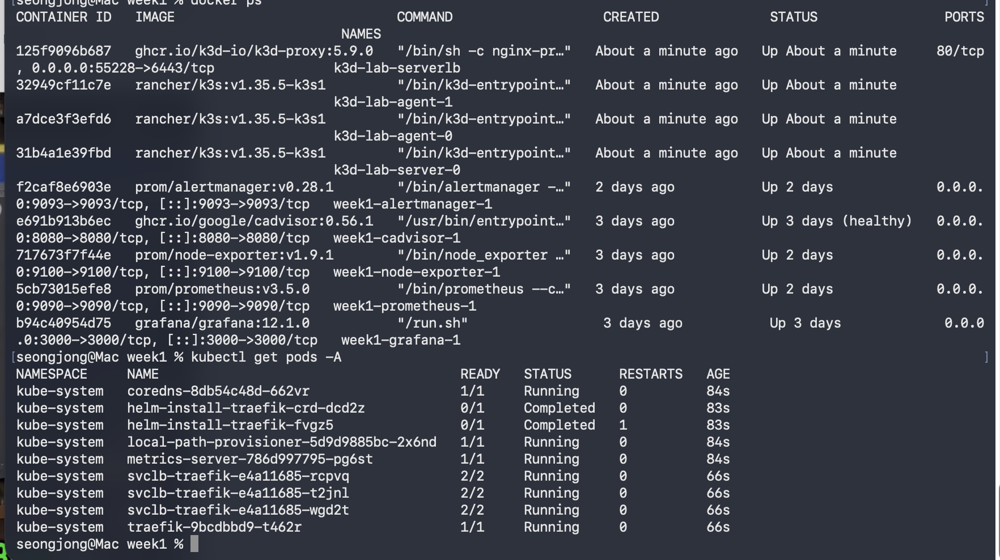
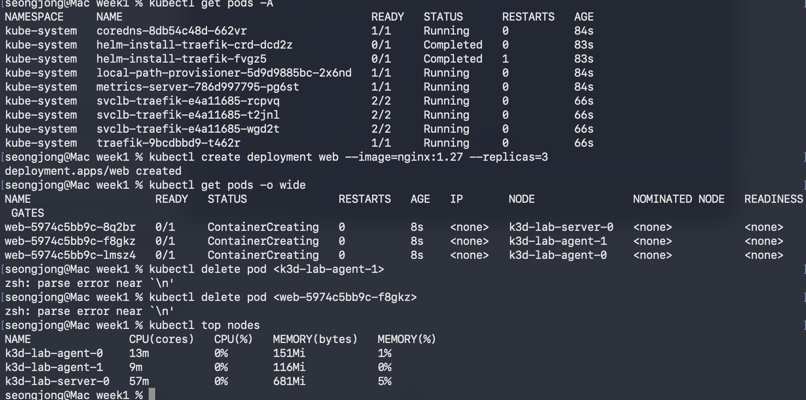
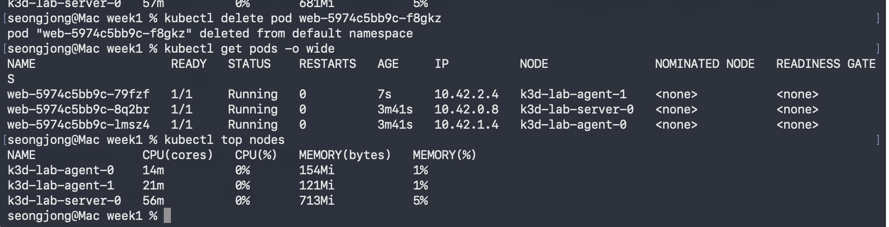
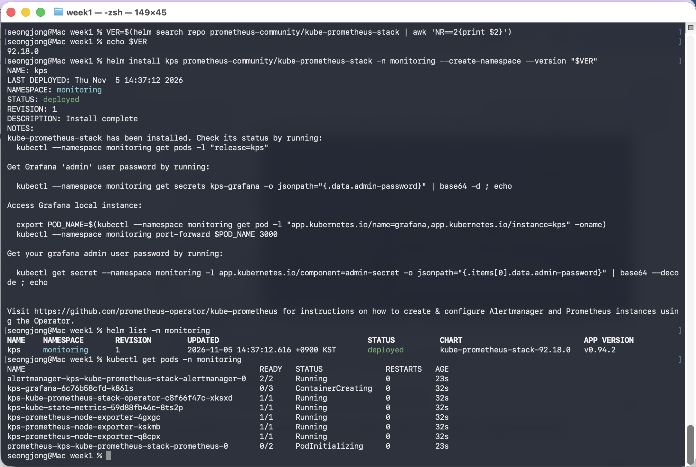
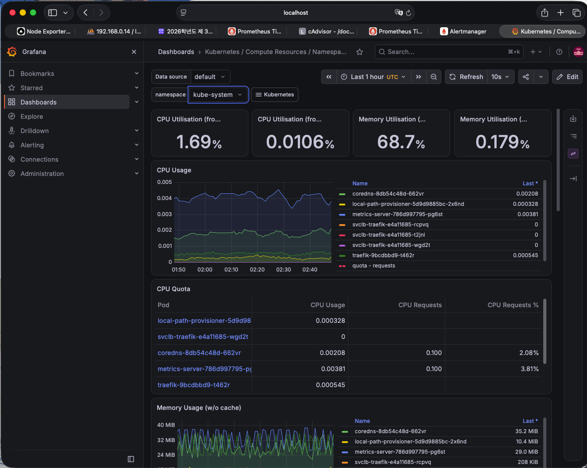
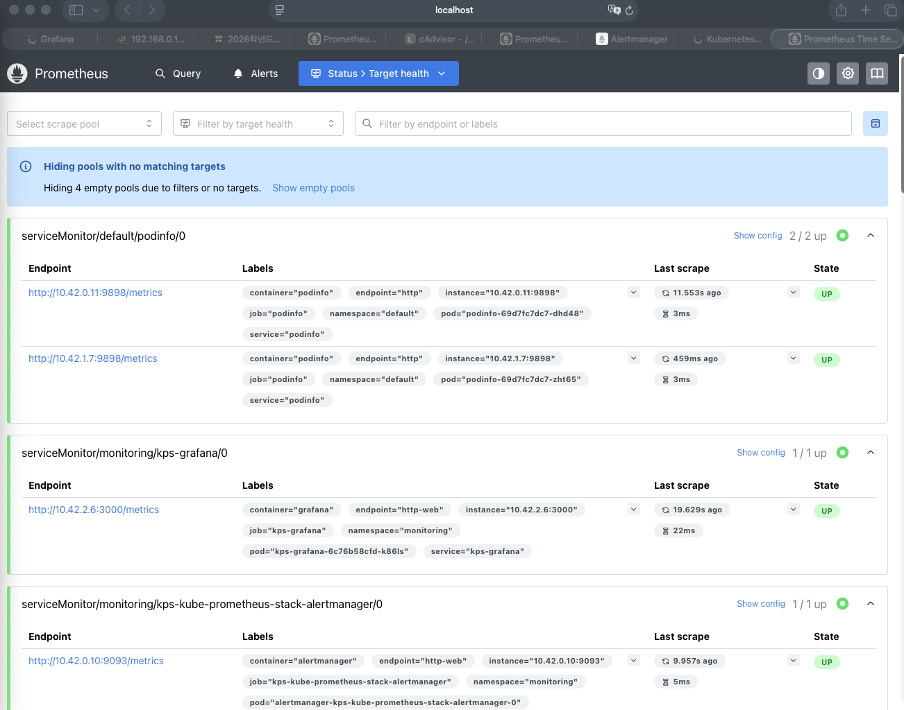
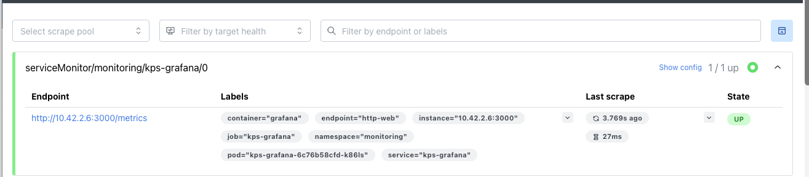
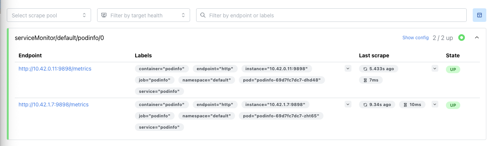
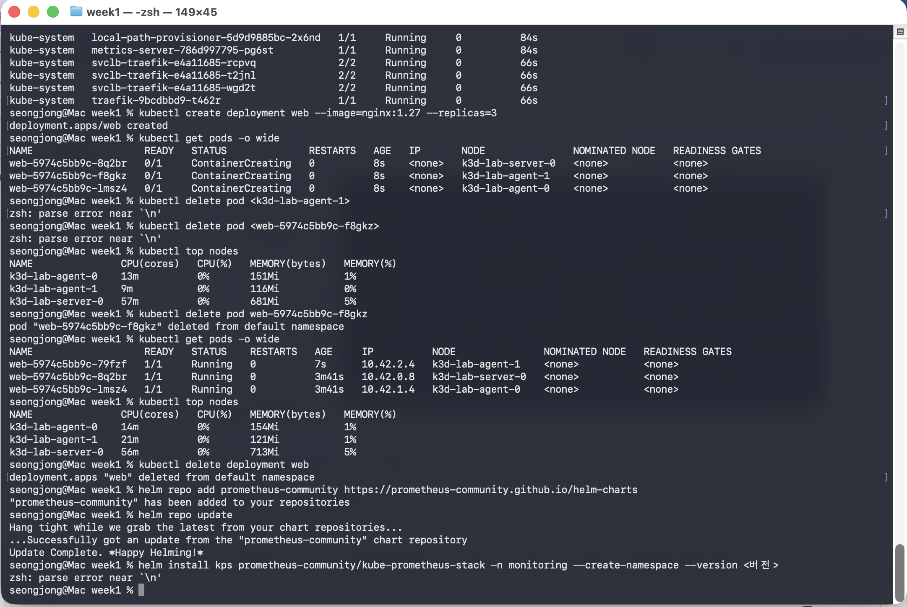
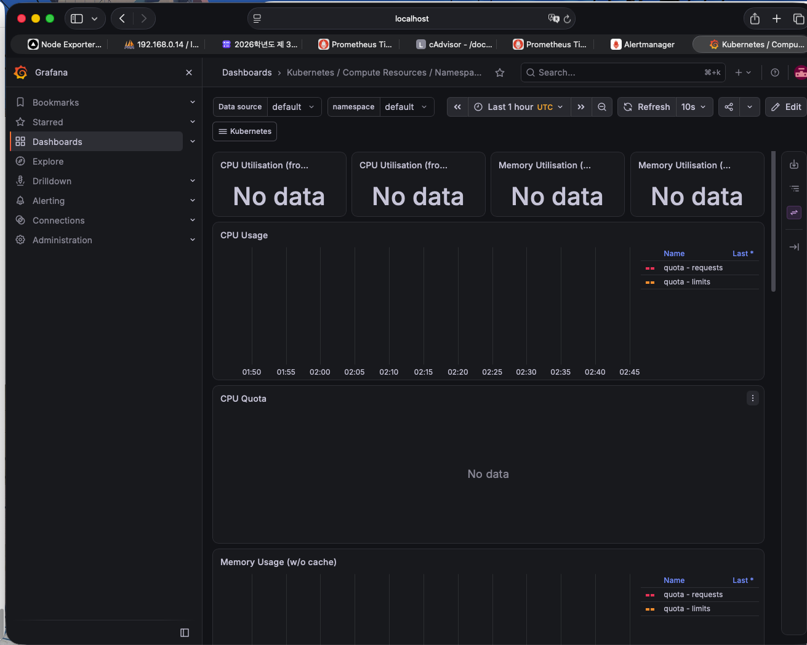

# 서버 운영 학습 일지

> 맥(Apple Silicon)에서 Docker/K8s 모니터링 스택을 직접 띄우고, 일부러 망가뜨려서 알림까지 받아보기
> 이 문서 하나에 진행할 때마다 내용을 추가·수정해 나간다.

| rev | 날짜 | 내용 |
|---|---|---|
| rev1 | 2026-10-30 (금) | 1주차 Day 1 ~ Day 2·3 |
| rev2 | 2026-11-02 (월) | 1주차 Day 4 추가, 10/30 내용에 스크린샷 삽입 |
| rev3 | 2026-11-03 (화) | 1주차 Day 5 추가 (알림), "추가로 해볼 수 있는 것" 섹션 신설 |
| rev4 | 2026-11-06 (금) | 2주차 Day 1~3 추가 (11/05~11/06), 1주차 Grafana 쿠키 이름 변경 반영, 접속 주소에 2주차 추가 |

---

## 진행 현황

| 주차 | 단계 | 내용 | 날짜 | 상태 |
|---|---|---|---|---|
| 1주차 | Day 1 | OrbStack, Ubuntu VM, kubectl/helm/k3d 설치 | 10/30 | 완료 |
| 1주차 | Day 2·3 | Prometheus + node-exporter + Grafana, PromQL, 대시보드 | 10/30 | 완료 |
| 1주차 | Day 4 | cAdvisor 컨테이너 지표, Node Exporter Full(1860) | 11/02 | 완료 |
| 1주차 | Day 5 | Alertmanager + 알림 규칙 (HighCPU, TargetDown 실습) | 11/03 | 완료 |
| 2주차 | Day 1 | k3d 클러스터(노드 3개), 파드 배치·자동 복구 | 11/05 | 완료 |
| 2주차 | Day 2 | kube-prometheus-stack(차트 92.18.0), Operator, requests/limits | 11/05~06 | 완료 |
| 2주차 | Day 3 | podinfo + ServiceMonitor, `release: kps` 라벨 실험 | 11/06 | 완료 |
| 2주차 | Day 4 | 장애 실습 (CrashLoopBackOff, OOMKilled, 노드 장애) | | 예정 |
| 2주차 | Day 5 | 정리 (구성도, 교수님 보고용 요약) | | 예정 |

**현재 구성 (최신)**: Prometheus v3.5.0 · node-exporter v1.9.1 · Grafana 12.1.0 · cAdvisor 0.56.1 (ghcr.io) · Alertmanager v0.28.1 — 최종 compose 파일은 [Day 5](#day-5--알림-alertmanager) 참고

**2주차 구성**: k3d 클러스터 `lab` (k3s v1.35.5, server 1 + agent 2) · kube-prometheus-stack 92.18.0 (`monitoring` namespace) · podinfo 6.7.1 (`default` namespace) — [2주차](#2주차--쿠버네티스-위로-옮기기) 참고

### 접속 주소 — 1주차 (로컬, `docker compose up -d` 상태에서)

| 서비스 | 주소 | 용도 |
|---|---|---|
| Prometheus | http://localhost:9090 | PromQL 쿼리 (Query 탭) |
| Prometheus Targets | http://localhost:9090/targets | 수집 대상 UP/DOWN 확인 |
| Prometheus Alerts | http://localhost:9090/alerts | 알림 규칙 상태 (Day 5) |
| Grafana | http://localhost:3000 | 대시보드 (첫 로그인 admin / admin → 변경 권장) |
| node-exporter | http://localhost:9100/metrics | 호스트 지표 원본 |
| cAdvisor | http://localhost:8080 | 컨테이너 지표 웹 UI (`/metrics`는 원본) |
| Alertmanager | http://localhost:9093 | 알림 수신 확인 (Day 5) |

### 접속 주소 — 2주차 (port-forward를 켜둔 동안만)

| 서비스 | port-forward 명령 (새 터미널 탭에서) | 주소 |
|---|---|---|
| Grafana | `kubectl port-forward -n monitoring svc/kps-grafana 3001:80` | http://localhost:3001 |
| Prometheus | `kubectl port-forward -n monitoring svc/kps-kube-prometheus-stack-prometheus 9091:9090` | http://localhost:9091 |

- 2주차 Grafana 비밀번호: `kubectl --namespace monitoring get secrets kps-grafana -o jsonpath="{.data.admin-password}" | base64 -d ; echo`
- `localhost` 주소는 **이 맥에서만** 의미가 있음. 다른 컴퓨터에서 클릭하면 그 컴퓨터 자신을 가리켜서 열리지 않음. 반대로 1주차 포트는 `0.0.0.0`으로 열려 있어 **같은 와이파이의 다른 사람은 `맥IP:3000`으로 접근 가능** (아래 "추가로 해볼 수 있는 것" 4번)

### 참고 사이트

| 주제 | 주소 |
|---|---|
| Prometheus 문서 | https://prometheus.io/docs/ |
| Prometheus + cAdvisor 가이드 | https://prometheus.io/docs/guides/cadvisor/ |
| Grafana 대시보드 1860 (Node Exporter Full) | https://grafana.com/grafana/dashboards/1860 |
| cAdvisor 저장소·릴리스 | https://github.com/google/cadvisor/releases |
| cAdvisor × Docker 29 containerd-snapshotter 이슈 | https://github.com/google/cadvisor/issues/3643 |
| kube-prometheus-stack 차트 (2주차) | https://github.com/prometheus-community/helm-charts/tree/main/charts/kube-prometheus-stack |
| Prometheus Operator (ServiceMonitor 등) | https://prometheus-operator.dev |
| podinfo | https://github.com/stefanprodan/podinfo |
| k3d | https://k3d.io |
| OrbStack | https://orbstack.dev |

---

## 2026-10-30 (금) · Day 1 ~ Day 2·3

### Day 1 · 환경 준비

#### 설치한 것과 역할

| 도구 | 버전 | 무엇인가 |
|---|---|---|
| OrbStack | 2.2.5 | 맥에서 리눅스 VM과 Docker 엔진을 가볍게 돌려주는 앱. Docker Desktop 대체 |
| Docker | 29.6.1 | 컨테이너를 만들고 실행하는 도구 |
| kubectl | 1.37.2 | 쿠버네티스 클러스터에 명령을 내리는 CLI |
| Helm | 4.3.1 | 쿠버네티스용 패키지 매니저 (여러 리소스를 묶어서 한 번에 설치) |
| k3d | 5.9.0 (k3s 1.35.5) | Docker 컨테이너 안에 경량 쿠버네티스(k3s) 클러스터를 띄우는 도구 |
| Ubuntu VM `lab` | Ubuntu 26.04.1 LTS, aarch64 | 리눅스 운영 실습용 VM |

#### 맥 터미널 vs lab VM 역할 구분

- **맥 터미널** (`seongjong@Mac`): `brew`로 설치, `docker` / `kubectl` / `k3d` 실행
- **lab VM** (`seongjong@lab`, `orb -m lab`으로 접속): systemd, ufw, 계정 관리 같은 리눅스 운영 실습용. 패키지 설치는 `apt`
- VM 안에서 `brew`가 안 되는 건 정상 (리눅스는 `apt`)


*`orb create ubuntu lab` → `orb -m lab`으로 접속, Ubuntu 26.04.1 / aarch64 확인*

#### 확인 명령

```bash
docker run --rm hello-world
kubectl version --client
helm version
k3d version
```


*kubectl·helm·k3d 설치 후 hello-world 성공, 각 도구 버전 확인*

---

### Day 2·3 · Docker compose로 모니터링 스택 띄우기

#### 구성 요소

| 컨테이너 | 역할 | 포트 |
|---|---|---|
| **Prometheus** | 메트릭을 주기적으로 긁어와(scrape) 시계열로 저장하고, PromQL로 조회 | 9090 |
| **node-exporter** | 호스트(리눅스)의 CPU·메모리·디스크 등 지표를 `/metrics`로 노출 | 9100 |
| **Grafana** | Prometheus 데이터를 대시보드로 시각화 | 3000 |

흐름: `node-exporter`가 지표를 노출 → `Prometheus`가 15초마다 가져가 저장 → `Grafana`가 Prometheus에 쿼리해서 그림으로 표시

#### 폴더 구조

```
~/server-study/week1/
├── docker-compose.yml
├── prometheus/
│   └── prometheus.yml
└── alertmanager/        (Day 5에서 사용)
```

#### docker-compose.yml

```yaml
services:
  prometheus:
    image: prom/prometheus:v3.5.0
    volumes:
      - ./prometheus:/etc/prometheus
      - prom-data:/prometheus
    ports: ["9090:9090"]

  node-exporter:
    image: prom/node-exporter:v1.9.1
    pid: host
    volumes:
      - /proc:/host/proc:ro
      - /sys:/host/sys:ro
      - /:/rootfs:ro
    command:
      - --path.procfs=/host/proc
      - --path.sysfs=/host/sys
      - --path.rootfs=/rootfs
    ports: ["9100:9100"]

  grafana:
    image: grafana/grafana:12.1.0
    ports: ["3000:3000"]
    volumes:
      - grafana-data:/var/lib/grafana

volumes:
  prom-data:
  grafana-data:
```

> 11/02 Day 4에서 `restart: unless-stopped`와 cAdvisor가 추가됨 → 최종본은 아래 [Day 4](#day-4--컨테이너-메트릭) 참고

**원래 계획서에서 바꾼 점**
- 이미지 태그를 `latest` → **버전 고정**. `latest`는 시점마다 다른 이미지가 받아져서 재현이 안 되고, 인수인계 문서로 쓸 수 없음
- node-exporter에 **`/:/rootfs` 마운트 + `--path.rootfs`** 추가. 이게 없으면 파일시스템 지표가 컨테이너 자신의 것만 보이거나 비어서 디스크 모니터링이 의미 없어짐

**설정 항목 설명**
- `pid: host` — node-exporter가 컨테이너가 아니라 호스트의 프로세스 정보를 보게 함
- `:ro` — 읽기 전용 마운트. 모니터링 도구가 호스트 파일을 실수로 바꾸지 못하게
- `volumes: prom-data, grafana-data` — 이름 있는 볼륨. 컨테이너를 지웠다 다시 만들어도 수집 데이터와 대시보드가 유지됨

#### prometheus/prometheus.yml

```yaml
global:
  scrape_interval: 15s

scrape_configs:
  - job_name: prometheus
    static_configs:
      - targets: ["localhost:9090"]

  - job_name: node
    static_configs:
      - targets: ["node-exporter:9100"]
```

- `scrape_interval: 15s` — 15초마다 각 타깃에서 지표를 가져옴
- `job_name` — 수집 대상 묶음 이름. 쿼리 결과의 `job` 라벨이 됨

#### 실행

```bash
cd ~/server-study/week1
docker compose up -d
docker compose ps
```

- http://localhost:9090/targets 에서 `prometheus`, `node` 둘 다 **UP** 확인
- OrbStack 앱에서 컨테이너 3개가 `week1` 그룹으로 묶여 보임 → compose 프로젝트 이름은 **폴더 이름**


*`docker compose ps`로 컨테이너 3개 Up 확인, OrbStack 앱에서 `week1` 그룹으로 표시*

#### 핵심 개념: 서비스 이름으로 통신되는 이유

Grafana 데이터소스에 `localhost:9090`이 아니라 **`http://prometheus:9090`** 을 넣어야 했다.

- 컨테이너 안에서 `localhost`는 **그 컨테이너 자기 자신**이다. Grafana 컨테이너 안에는 Prometheus가 없으므로 `localhost:9090`은 실패한다.
- docker compose는 같은 파일의 서비스들을 **하나의 기본 네트워크**로 묶고, 그 네트워크 안에서 **서비스 이름을 DNS 이름처럼** 쓸 수 있게 해준다.
- 그래서 `prometheus.yml`의 `node-exporter:9100`, Grafana의 `prometheus:9090`이 동작한다.
- 반대로 브라우저(맥)에서 접속할 때는 `ports`로 열어둔 `localhost:9090`, `localhost:3000`을 쓴다.


*Grafana 데이터소스에 `http://prometheus:9090` 연결*

#### PromQL 쿼리

| 지표 | 쿼리 | 설명 |
|---|---|---|
| 수집 상태 | `up` | 타깃이 살아 있으면 1, 아니면 0 |
| CPU 사용률 | `100 - (avg(rate(node_cpu_seconds_total{mode="idle"}[1m])) * 100)` | 최근 1분간 idle(쉬는) 시간 비율을 구해 100에서 뺌 |
| 메모리 사용률 | `100 - node_memory_MemAvailable_bytes / node_memory_MemTotal_bytes * 100` | 가용 메모리 비율을 100에서 뺌 |
| 디스크 사용률 | `100 - node_filesystem_avail_bytes{mountpoint="/var/lib/docker"} / node_filesystem_size_bytes{mountpoint="/var/lib/docker"} * 100` | OrbStack 환경 기준 (아래 트러블슈팅 참고) |

- `rate(...[1m])` — 계속 증가하기만 하는 카운터 값을 "1분 동안 초당 얼마나 늘었나"로 바꿔줌
- `{mode="idle"}` — 라벨로 원하는 시계열만 골라냄
- 지표 값은 **맥이 아니라 OrbStack 리눅스 VM 기준**. 메모리 총량이 맥 24GB보다 작게 나오는 게 정상


*PromQL로 조회한 메모리 가용률. Y축이 93.2~93.9 사이로 확대돼 있어 출렁이는 것처럼 보임*

#### Grafana 대시보드 `week1 서버 모니터링`

| 패널 | 시각화 | 설정 |
|---|---|---|
| CPU 사용률 | Time series | Unit `Percent (0-100)`, Min 0 / Max 100 |
| 메모리 사용률 | Time series | Unit `Percent (0-100)`, Min 0 / Max 100 |
| 디스크 사용률 | Gauge | Unit `Percent (0-100)`, Min 0 / Max 100, Thresholds 70(노랑)·90(빨강) |


*패널 편집 화면. Code 모드로 쿼리 입력, 오른쪽 Standard options에서 Unit 지정*


*디스크 게이지(70/90 임계값) + 메모리·CPU 시계열 패널*

**설계 이유**
- **Min/Max 0~100 고정**: 고정하지 않으면 Grafana가 Y축을 값 범위에 맞춰 확대해서, 0.29%짜리 디스크도 크게 출렁이는 것처럼 보인다.
- **단위 Percent (0-100)**: 쿼리에서 `* 100`을 했으므로 0-100. `* 100`을 안 했다면 `Percent (0.0-1.0)`. 잘못 고르면 50%가 5000%로 표시됨. (단위는 `Misc` 카테고리에 있고, Unit 칸에 `percent`를 타이핑하면 빠름)
- **지표 방향 통일**: 세 패널 모두 "**높을수록 위험**"인 사용률로 통일. 가용률과 사용률이 섞이면 보는 사람이 반대로 해석할 수 있음
- **디스크는 게이지**: 디스크는 시간에 따른 변화보다 "지금 얼마나 찼나"가 중요. CPU처럼 출렁이는 값은 시계열 그래프가 맞음
- **임계값 90**: Day 5에 만들 디스크 알림 기준(90%)과 맞춤. 대시보드 색과 알림 기준이 다르면 운영 시 혼란

#### Grafana 그래프는 실시간으로 바뀌나?

- **데이터 수집**은 계속된다. Prometheus는 브라우저를 열든 말든 15초마다 값을 가져와 저장한다.
- **화면**은 기본적으로 자동 갱신되지 않는다. 대시보드를 연 시점에 한 번 쿼리해서 그린 그림이다.
- 자동 갱신: 대시보드 오른쪽 위 **Refresh ▾** → `15s` 또는 `30s` → **Save dashboard**
- 화면 갱신 주기는 **수집 주기(15초)보다 짧게 할 필요가 없다.** 5초마다 다시 그려도 같은 점을 반복해서 그릴 뿐이고, 여러 명이 대시보드를 띄워두는 서버에서는 Prometheus에 불필요한 부하가 된다.
- 맥이 **잠자기**에 들어가면 OrbStack VM도 멈춰서 그 구간은 수집되지 않는다 → 그래프에 끊긴 구간으로 보임. 실제 서버에서 이런 공백이 생기면 "서버나 수집기가 죽었었다"는 신호다.

---

### 막혔던 것 / 해결 방법 (10/30)

#### 1. `brew install orbstack` 실패 — TLS 에러

```
curl: (35) LibreSSL/3.3.6: error:1404B42E:SSL routines:ST_CONNECT:tlsv1 alert protocol version
```


- **원인**: Homebrew가 설치 파일을 받을 때 HTTPS 연결 협상(TLS) 단계에서 거부됨. macOS 기본 curl(LibreSSL)과 서버 설정이 안 맞거나, 네트워크가 HTTPS를 막는 경우
- **해결 방법 후보**: `brew install curl` 후 `export HOMEBREW_FORCE_BREWED_CURL=1`로 Homebrew판 curl 사용 / 공식 사이트에서 dmg 직접 다운로드 / 다른 네트워크(핫스팟)로 시도
- **실제로 해결된 방법**: (직접 기록)

#### 2. `docker version`에서 데몬 연결 실패

```
Cannot connect to the Docker daemon at unix:///Users/seongjong/.docker/run/docker.sock
```

- **원인**: Docker Desktop이 이미 설치돼 있어서 docker 컨텍스트가 `desktop-linux`(Docker Desktop)를 가리키고 있었고, Docker Desktop은 꺼져 있었음
- **해결**: `docker context use orbstack`
- **교훈**: Docker Desktop과 OrbStack을 동시에 쓰면 어느 엔진에 컨테이너를 띄웠는지 헷갈림. Docker Desktop은 종료하고 자동 실행 끄기


*`orbstack` 컨텍스트로 전환, `which -a kubectl`로 kubectl이 여러 곳에 있음을 확인*

#### 3. kubectl 버전이 brew로 설치한 것과 다르게 나옴

- brew로 1.37.2를 설치했는데 `kubectl version --client`가 **1.36.1**
- `which -a kubectl`과 `ls -l`로 확인:
  - `/opt/homebrew/bin/kubectl` → brew의 1.37.2
  - `/usr/local/bin/kubectl` → Docker.app 안의 1.36.1
- **원인**: PATH 순서상 brew판이 먼저인데도, zsh가 예전에 찾아둔 명령 위치를 **캐시**해서 계속 Docker Desktop판을 실행함
- **해결**: `rehash` (zsh 명령 위치 캐시 초기화) → 1.37.2 확인
- **교훈**: "지금 실행되는 바이너리가 어느 것인지" 확인하는 습관 (`which -a`, `ls -l`). 서버에서도 자주 쓰임
- 참고: PATH에 `/opt/homebrew/bin`이 중복으로 들어가 있음 → `~/.zprofile`의 `brew shellenv` 중복 의심, 나중에 정리

#### 4. 명령어 옆 `# 주석`이 인자로 들어감

- `rehash   # zsh 캐시 초기화`를 붙여넣었더니 `rehash: too many arguments`
- **원인**: zsh는 대화형 터미널에서 `#`을 주석으로 인식하지 않는 게 기본값
- **해결**: 명령만 한 줄씩 실행. (원하면 `~/.zshrc`에 `setopt interactivecomments` 추가)


*`#` 뒤 글자들이 `ls`의 인자로 들어가 에러. 아래 `ls -l` 결과로 두 kubectl의 실제 위치 확인*

#### 5. 디스크 쿼리 결과가 비어 있음 (`mountpoint="/"`)

- CPU·메모리 쿼리는 되는데 디스크 쿼리만 `Empty query result`


- 조건을 빼고 `node_filesystem_size_bytes`로 전체 목록을 확인:
  - `device="mac"`, `fstype="virtiofs"` (~1TB): OrbStack이 **맥의 디스크를 VM에 공유**한 것. VM 디스크가 아니므로 모니터링 대상 아님
  - `device="/dev/vdb1"`, `fstype="btrfs"`: **OrbStack VM의 실제 디스크**. `/var/lib/docker`, `/var/lib/cni`, `/etc/rancher/node`, `/opt/orbstack-guest/data` 등 여러 곳에 마운트되어 선이 여러 개로 보임
  - **`mountpoint="/"`는 목록에 없음** → 그래서 결과가 비었던 것


*위쪽 큰 선(~1TB)은 맥 디스크 공유분(virtiofs), 아래쪽이 VM 실제 디스크(/dev/vdb1, btrfs)*

- **해결**: 컨테이너 이미지·볼륨이 쌓이는 `mountpoint="/var/lib/docker"` 기준으로 쿼리 변경


*약 0.29%. Y축이 0.28~0.30으로 확대돼 있어 크게 변하는 것처럼 보이지만 실제로는 거의 변화 없음*

- **교훈**
  - 쿼리를 쓰기 전에 **조건 없이 먼저 목록을 보고** 라벨 값을 확인할 것
  - 알림 규칙도 환경마다 달라야 한다. 계획서 Day 5의 `DiskAlmostFull`도 `mountpoint="/"`라 이대로면 **에러 없이 영원히 안 울리는 알림**이 됨 → Day 5에 수정 예정
  - 학교 서버(일반 Ubuntu)라면 보통 `mountpoint="/"`, `fstype="ext4"`이고 데이터 디스크가 `/data` 등에 따로 있을 수 있음. 실제 서버에서도 목록부터 확인

#### 6. Prometheus 그래프 시간이 9시간 다름

- 11시대인데 그래프에 02시대로 표시 (위 메모리 그래프 스크린샷의 시간축 참고)
- **원인**: Prometheus UI 기본값이 UTC
- **해결**: 오른쪽 위 ⚙ → **Use local time**
- **교훈**: 서버 로그와 그래프를 대조할 때 시간대를 먼저 확인

#### 7. Grafana 메모리 패널 제목과 값이 안 맞음

- 제목은 "사용률"인데 쿼리는 가용률(약 93%) → 메모리가 거의 꽉 찬 것처럼 보임


*제목은 `메모리 사용률`인데 값은 가용률(약 93%)*

- 수정 과정에서 쿼리와 제목을 둘 다 바꿔 다시 반대로 어긋남 (제목 `메모리 가용률`, 값은 사용률 약 7% — 위 "완성된 대시보드" 스크린샷)
- **해결**: 쿼리를 사용률(`100 - ...`)로, 제목을 `메모리 사용률`로 맞춤
- **교훈**: 대시보드에서 제목·단위·쿼리 방향이 어긋나면 운영자가 정반대로 판단할 수 있음. 패널을 고치면 **쿼리와 제목을 함께** 확인

---

### 그래프 읽는 법 메모

- 그래프는 **Y축 범위부터** 확인. 디스크 사용률 그래프가 크게 출렁여 보였지만 실제로는 0.28~0.30% 사이 변화
- 11:20 직전 CPU가 40~50% 근처로 튄 것, 디스크가 살짝 늘어난 것은 `docker compose up` 때 이미지 3개를 받고 컨테이너를 동시에 띄운 흔적

---

---

## 2026-11-02 (월) · Day 4

### Day 4 · 컨테이너 메트릭

#### cAdvisor란

| 수집기 | 보는 대상 | 답해주는 질문 |
|---|---|---|
| **node-exporter** | 호스트(VM) 전체 | 서버 전체가 얼마나 바쁜가? |
| **cAdvisor** | 컨테이너 하나하나 | 그중 **어떤 컨테이너가** 바쁜가? |

> **정리**: 서버가 느려지면 node-exporter로 이상을 감지하고, cAdvisor로 원인 컨테이너를 찾는다.
> 쿠버네티스에서는 kubelet 안에 cAdvisor가 내장되어 같은 역할을 한다 (2주차에서 확인).

#### docker-compose.yml (Day 4 시점)

> 11/03 Day 5에서 Alertmanager가 추가됨 → 최종본은 아래 [Day 5](#day-5--알림-alertmanager) 참고

```yaml
services:
  prometheus:
    image: prom/prometheus:v3.5.0
    restart: unless-stopped
    volumes:
      - ./prometheus:/etc/prometheus
      - prom-data:/prometheus
    ports: ["9090:9090"]

  node-exporter:
    image: prom/node-exporter:v1.9.1
    restart: unless-stopped
    pid: host
    volumes:
      - /proc:/host/proc:ro
      - /sys:/host/sys:ro
      - /:/rootfs:ro
    command:
      - --path.procfs=/host/proc
      - --path.sysfs=/host/sys
      - --path.rootfs=/rootfs
    ports: ["9100:9100"]

  grafana:
    image: grafana/grafana:12.1.0
    restart: unless-stopped
    ports: ["3000:3000"]
    volumes:
      - grafana-data:/var/lib/grafana

  cadvisor:
    image: ghcr.io/google/cadvisor:0.56.1
    restart: unless-stopped
    privileged: true
    devices:
      - /dev/kmsg
    volumes:
      - /:/rootfs:ro
      - /var/run:/var/run:ro
      - /sys:/sys:ro
      - /var/lib/docker/:/var/lib/docker:ro
    command:
      - --containerd=/run/docker/containerd/containerd.sock
      - --containerd-namespace=moby
    ports: ["8080:8080"]

volumes:
  prom-data:
  grafana-data:
```

**10/30 대비 바뀐 점**
- **`restart: unless-stopped`** (전 서비스): OrbStack이나 서버가 재시작돼도 컨테이너가 자동으로 다시 뜸. 직접 `docker compose stop`으로 멈춘 경우만 예외. 주말 동안 맥이 재시작되면서 컨테이너가 안 올라와 있던 걸 계기로 추가
- **cAdvisor 추가**
  - `privileged: true`, `/var/lib/docker` 마운트: 다른 컨테이너들의 정보를 들여다봐야 해서 높은 권한이 필요함. **모니터링 도구가 높은 권한을 갖는다는 점은 실제 서버에서 보안 검토 대상**
  - `command`의 containerd 옵션 두 줄: Docker 29 호환을 위해 필요 (아래 트러블슈팅 8 참고)

#### prometheus/prometheus.yml (Day 4 시점)

```yaml
global:
  scrape_interval: 15s

scrape_configs:
  - job_name: prometheus
    static_configs:
      - targets: ["localhost:9090"]

  - job_name: node
    static_configs:
      - targets: ["node-exporter:9100"]

  - job_name: cadvisor
    static_configs:
      - targets: ["cadvisor:8080"]
```

#### 반영 절차

```bash
cd ~/server-study/week1
docker compose config --quiet
docker compose up -d
docker compose restart prometheus
docker compose ps
```

- `docker compose config --quiet`: YAML 문법만 미리 검사. **출력이 없으면 정상**, 들여쓰기가 깨졌으면 몇 번째 줄인지 알려줌. 파일을 통째로 바꿀 때 먼저 확인하는 습관
- `docker compose restart prometheus`: compose 정의는 그대로고 **설정 파일만** 바뀐 경우 `up -d`가 컨테이너를 다시 만들지 않으므로, 재시작해서 설정을 다시 읽게 함


*cAdvisor 포함 4개 컨테이너 기동, cadvisor는 `(healthy)`*

#### 컨테이너별 CPU 쿼리

```
sum by (image) (rate(container_cpu_usage_seconds_total{name!=""}[1m]))
```

- `{name!=""}` — 이름 없는 시계열(cgroup 전체 합계 등)을 제외
- `sum by (image)` — 이미지 이름별로 묶어서 합침. 범례가 짧고 읽기 쉬워짐
- 우리 환경에서는 `name` 라벨이 컨테이너 **이름이 아니라 ID**로 나와서 `image` 라벨로 구분 (트러블슈팅 8 참고)


*`image` 라벨별로 선이 나뉨 — prometheus, node-exporter 등 컨테이너 단위 구분 성공*

**단위 읽는 법**
- 값의 단위는 **CPU 코어 수**. Y축의 `4.50m` = **0.0045 코어** (코어 하나의 0.45%)
- `m`은 밀리(1/1000). 쿠버네티스에서 `cpu: 500m`(0.5코어)처럼 자원을 지정할 때 같은 단위를 씀
- 노드 CPU 사용률(%)과 단위가 다르니 주의

#### Node Exporter Full 대시보드 (ID 1860)

1. Grafana → **Dashboards** → **New** → **Import**
2. `1860` 입력 → **Load** → **Import**
3. 데이터소스 선택 칸이 없는 건 정상. 최신 버전은 Grafana의 **기본(default) 데이터소스**를 자동으로 사용


**화면 해석**

| 보이는 것 | 의미 |
|---|---|
| CPU Cores 15 / RAM Total 12 GiB | 맥(24GB)이 아니라 **OrbStack VM 기준** 값 |
| Root FS Used: N/A | 이 대시보드도 `mountpoint="/"` 기준이라 OrbStack에서 값 없음 (트러블슈팅 5와 같은 원인). 학교 서버에서는 정상 표시 예상 |
| Pressure: No data | 커널 자원 압박 지표(PSI). OrbStack VM 환경에서 수집 안 되는 것으로 보임 |
| 그래프 중간 끊긴 구간 | 맥 **잠자기** 동안 수집이 멈춘 흔적 |
| Network Traffic 마이너스 값 | 고장 아님. 받는 트래픽(Rx)은 위로, 보내는 트래픽(Tx)은 **아래로** 그리는 표시 방식 |
| Disk Space에 `/Applications`, `/Users` 등 | 맥 디스크 공유분(virtiofs)이 같이 잡힘 |

**대시보드 변수**: 상단의 Datasource / Job / Nodename / Instance 드롭다운. 대시보드 하나로 서버 여러 대를 골라 볼 수 있게 해줌. 학교 서버 여러 대에 node-exporter를 깔면 목록에 서버들이 나란히 뜸

**교훈**
- 남이 만든 대시보드에는 **우리 환경에 안 맞는 부분**이 꼭 있다. 그대로 믿지 말고 패널별로 확인
- 커뮤니티 대시보드는 작성자가 계속 고친다 (이번에 받은 건 2026-10-31 업데이트판). 운영 환경에서는 가져온 대시보드를 **JSON으로 내보내 저장소에 보관** — 이미지 버전 고정과 같은 이유

---

### 막혔던 것 / 해결 방법 (11/02)

#### 8. 컨테이너별 지표가 안 잡힘 — cAdvisor ↔ Docker 29 호환 문제 (오늘의 메인)

`rate(container_cpu_usage_seconds_total{name!=""}[1m])` 결과가 비어 있음


조건을 빼고 조회하니 컨테이너 이름 없이 큰 묶음 4개(`/`, `/docker`, `/init.scope`, `/.lxc`)만 존재


해결까지 세 단계를 거침.

**① 원인 파악 — cAdvisor 로그**

```bash
docker compose logs cadvisor | grep -i docker
```
```
Failed to create existing container: /docker/717673f7...
open /rootfs/var/lib/docker/image/overlayfs/layerdb/mounts/.../mount-id: no such file or directory
```

- cAdvisor가 컨테이너 정보를 얻으려고 Docker의 **옛날 이미지 저장 위치**(`/var/lib/docker/image/.../layerdb`)를 찾는데 파일이 없음
- **Docker 29부터 containerd 이미지 저장소(containerd-snapshotter)가 기본값**이 되면서 저장 구조가 바뀜
- cAdvisor v0.49.1(2024년 버전)은 옛 구조만 알아서 컨테이너를 하나도 등록하지 못함
- 처음에는 Docker API 버전 문제로 추측했지만 **로그를 보니 원인이 달랐음** → 추측보다 로그가 먼저

**② 최신 cAdvisor로 교체 — 이미지 태그 함정**

- containerd-snapshotter 지원은 최신 cAdvisor에 추가됨. 이 버전부터 이미지 저장소가 `gcr.io` → **`ghcr.io`** 로 이동
- `ghcr.io/google/cadvisor:v0.55.0` → **`not found`**
  - ghcr.io 이미지는 태그에 **`v`가 붙지 않음**: `0.56.1` 형식
  - `up -d`가 실패하면 **기존 컨테이너가 그대로 돌아감** → 로그가 그대로라 "고쳤는데 그대로네"로 착각하기 쉬움. 바꾼 뒤엔 `docker compose ps`의 IMAGE 열로 실제 버전 확인
- `ghcr.io/google/cadvisor:0.56.1`로 교체 성공. `mount-id` 에러는 사라짐

**③ containerd 소켓 위치 지정**

새 로그:
```
Registration of the docker container factory failed:
unable to create containerd client: ... dial unix /run/containerd/containerd.sock: no such file or directory
```


- 새 cAdvisor는 containerd에 **직접 접속**하는데, 기본 위치(`/run/containerd/containerd.sock`, 별도 설치된 containerd 위치)에서 소켓을 못 찾음
- Docker에 딸린 containerd는 다른 위치에 소켓을 둠 → cAdvisor 컨테이너 안에서 실제 위치 찾기:

```bash
docker compose exec cadvisor find /var/run /run -name "containerd.sock" 2>/dev/null
```
→ `/run/docker/containerd/containerd.sock`


- cAdvisor **컨테이너 안에서** 찾은 이유: compose에서 `/var/run`을 마운트했으므로, cAdvisor 눈에 보이는 경로가 곧 설정에 써야 할 경로
- compose에 옵션 추가:
  ```yaml
      command:
        - --containerd=/run/docker/containerd/containerd.sock
        - --containerd-namespace=moby
  ```
  - `moby`: Docker가 containerd 안에서 자기 컨테이너들을 넣어두는 구역(namespace) 이름. 지정하지 않으면 쿠버네티스용 구역(`k8s.io`)을 찾아서 Docker 컨테이너가 안 보임
- **결과**: 컨테이너별 지표 수집 성공 (위 "컨테이너별 CPU" 스크린샷)
- **남은 한계**: Docker를 거치지 않고 containerd에서 직접 읽어서 `name` 라벨이 `week1-prometheus-1` 같은 이름이 아니라 **컨테이너 ID**로 나옴 → `image` 라벨로 구분

**교훈**
- 10/30에 "`latest` 대신 오래된 안정 버전으로 고정"한 선택이 **최신 Docker 엔진과 호환이 안 되는** 결과로 돌아옴. 버전 고정은 맞지만 **"무엇과 함께 돌아가는 버전인가"** 까지 확인해야 함
- 학교 서버도 Docker를 29로 올리는 순간 기존 cAdvisor가 **조용히** 깨질 수 있음 (컨테이너는 Up, 타깃도 UP인데 지표만 빠짐). **업그레이드 전 모니터링 스택 호환성 확인**은 서버장 체크리스트 항목
- 이미지 이름·태그는 **공식 README**에서 확인. 기억이나 블로그 글에 의존하면 `not found`

#### 9. prometheus.yml을 고쳤는데 반영이 안 됨

- 새 설정을 `week1/prometheus.yml`에 만들었는데, Prometheus가 읽는 파일은 **`week1/prometheus/prometheus.yml`** (폴더 안)
- compose에서 `./prometheus` **폴더**를 컨테이너의 `/etc/prometheus`로 연결했기 때문


*Targets에 cadvisor가 없음 — 예전 설정을 그대로 읽고 있었음*

- **해결**:
  ```bash
  mv prometheus.yml prometheus/prometheus.yml
  cat prometheus/prometheus.yml
  docker compose restart prometheus
  ```
- **교훈**: 설정을 바꿨는데 반영이 안 되면 **프로그램이 실제로 읽는 파일이 맞는지**부터 확인. 컨테이너에서는 compose의 `volumes`에 적힌 경로가 그 답. nginx, Prometheus 등 서버 운영에서 자주 겪는 유형

---

---

## 2026-11-03 (화) · Day 5

### Day 5 · 알림 (Alertmanager)

지금까지는 사람이 대시보드를 들여다봐야 이상을 알았다면, Day 5는 **조건을 걸어두고 넘으면 알려주게** 만드는 단계.

#### 구조

```
Prometheus ──(규칙 평가)──▶ 조건 충족 시 알림 발생 ──▶ Alertmanager ──▶ 수신처(Slack, Discord 등)
```

| 도구 | 하는 일 | 알림이 보이는 곳 |
|---|---|---|
| **Grafana** | 그래프로 **보여주기** | ✕ (대시보드는 그림만 그림) |
| **Prometheus** | 규칙으로 **판단하기** | http://localhost:9090/alerts |
| **Alertmanager** | 알림을 묶고, 중복을 거르고, **전달하기** | http://localhost:9093 |

#### 폴더 구조 (최종)

```
~/server-study/week1/
├── docker-compose.yml
├── prometheus/
│   ├── prometheus.yml
│   └── alert-rules.yml      ← 새로 추가 (prometheus 폴더 안!)
└── alertmanager/
    └── alertmanager.yml     ← 새로 추가
```

#### 최종 docker-compose.yml

```yaml
services:
  prometheus:
    image: prom/prometheus:v3.5.0
    restart: unless-stopped
    volumes:
      - ./prometheus:/etc/prometheus
      - prom-data:/prometheus
    ports: ["9090:9090"]

  node-exporter:
    image: prom/node-exporter:v1.9.1
    restart: unless-stopped
    pid: host
    volumes:
      - /proc:/host/proc:ro
      - /sys:/host/sys:ro
      - /:/rootfs:ro
    command:
      - --path.procfs=/host/proc
      - --path.sysfs=/host/sys
      - --path.rootfs=/rootfs
    ports: ["9100:9100"]

  grafana:
    image: grafana/grafana:12.1.0
    restart: unless-stopped
    environment:
      - GF_AUTH_LOGIN_COOKIE_NAME=grafana_session_week1   # 11/06 추가 (트러블슈팅 14)
    ports: ["3000:3000"]
    volumes:
      - grafana-data:/var/lib/grafana

  cadvisor:
    image: ghcr.io/google/cadvisor:0.56.1
    restart: unless-stopped
    privileged: true
    devices:
      - /dev/kmsg
    volumes:
      - /:/rootfs:ro
      - /var/run:/var/run:ro
      - /sys:/sys:ro
      - /var/lib/docker/:/var/lib/docker:ro
    command:
      - --containerd=/run/docker/containerd/containerd.sock
      - --containerd-namespace=moby
    ports: ["8080:8080"]

  alertmanager:
    image: prom/alertmanager:v0.28.1
    restart: unless-stopped
    volumes:
      - ./alertmanager:/etc/alertmanager
    ports: ["9093:9093"]

volumes:
  prom-data:
  grafana-data:
```

#### 최종 prometheus/prometheus.yml

```yaml
global:
  scrape_interval: 15s
  evaluation_interval: 15s

rule_files:
  - alert-rules.yml

alerting:
  alertmanagers:
    - static_configs:
        - targets: ["alertmanager:9093"]

scrape_configs:
  - job_name: prometheus
    static_configs:
      - targets: ["localhost:9090"]

  - job_name: node
    static_configs:
      - targets: ["node-exporter:9100"]

  - job_name: cadvisor
    static_configs:
      - targets: ["cadvisor:8080"]
```

- `rule_files` — 알림 규칙 파일 위치. `prometheus.yml`과 같은 폴더 기준 상대 경로
- `alerting` — 알림을 넘겨줄 Alertmanager 주소. compose 서비스 이름(`alertmanager`)으로 접근
- `evaluation_interval: 15s` — 규칙을 판단하는 주기. **기본값이 1분**이라 안 넣으면 조건을 넘고도 최대 1분 늦게 알아챔. 수집 주기(15초)에 맞춤

#### prometheus/alert-rules.yml

```yaml
groups:
  - name: node
    rules:
      - alert: HighCPU
        expr: 100 - (avg(rate(node_cpu_seconds_total{mode="idle"}[1m])) * 100) > 80
        for: 1m
        labels:
          severity: warning
        annotations:
          summary: "CPU 사용률 80% 초과 (1분 지속)"

      - alert: DiskAlmostFull
        expr: 100 - node_filesystem_avail_bytes{mountpoint="/var/lib/docker"} / node_filesystem_size_bytes{mountpoint="/var/lib/docker"} * 100 > 90
        for: 5m
        labels:
          severity: critical
        annotations:
          summary: "디스크 사용률 90% 초과"

      - alert: TargetDown
        expr: up == 0
        for: 30s
        labels:
          severity: critical
        annotations:
          summary: "{{ $labels.job }} 수집 대상이 응답하지 않음"
```

| 항목 | 의미 |
|---|---|
| `expr` | 이 쿼리 결과가 **참이면** 알림 후보. Day 2·3에서 만든 PromQL에 `> 80` 같은 조건을 붙인 것 |
| `for` | 조건이 **이 시간 동안 계속** 참이어야 진짜 알림(Firing). 그 전까지는 Pending |
| `labels.severity` | 심각도. 나중에 "critical은 Discord, warning은 이메일"처럼 **보낼 곳을 나누는 기준** |
| `annotations.summary` | 알림 설명 문구. `{{ $labels.job }}`처럼 **템플릿**으로 실제 라벨 값을 끼워 넣을 수 있음 |

**계획서에서 바꾼 점**
- **디스크 알림을 `mountpoint="/var/lib/docker"`로** — 10/30 트러블슈팅 5에서 확인한 대로 `"/"`는 OrbStack에 없어서, 원래대로면 **에러 없이 영원히 안 울리는 알림**이 됨
- **`TargetDown` 추가** — 실제 서버에서 가장 먼저 만드는 알림. 수집 대상이 죽으면 그 대상의 다른 알림이 전부 조용해지므로, **"감시 자체가 살아 있나"를 감시**
- **`evaluation_interval: 15s` 추가** (위 설명 참고)

#### alertmanager/alertmanager.yml

```yaml
route:
  receiver: default
receivers:
  - name: default
```

수신처를 비워둔 **최소 설정**. 알림이 Alertmanager까지 도착하는지 화면에서 확인만 하는 단계 (Discord 연결은 아래 "추가로 해볼 수 있는 것" 참고)

#### 반영 및 검사

```bash
cd ~/server-study/week1
docker compose config --quiet
docker compose up -d
docker compose exec prometheus promtool check rules /etc/prometheus/alert-rules.yml
docker compose restart prometheus
docker compose ps
```

- `promtool check rules` — Prometheus 이미지 안에 들어 있는 검사 도구로 **규칙 파일 문법만 미리 확인**. `SUCCESS: 3 rules found`면 정상
- `docker compose ps`에 alertmanager까지 **5개** 컨테이너가 Up이면 완료


*http://localhost:9090/alerts — `alert-rules.yml`의 규칙 3개가 모두 초록색 Inactive(조건 넘는 것 없음)*

#### 실습 1 · CPU 부하로 HighCPU 울리기

VM 코어가 15개라 **전체 평균 80%**를 넘기려면 코어 전부를 바쁘게 만들어야 함. 설치 없이 바로 되는 방법 사용:

```bash
docker run --rm --name cpu-load alpine sh -c 'for i in $(seq $(nproc)); do (while :; do :; done) & done; sleep 240'
```

- 코어 수(`nproc`)만큼 무한 반복을 동시에 돌리고 4분 뒤 자동 종료
- 계획서의 `ubuntu + apt install stress-ng` 방식은 패키지 설치 시간이 걸려서 대체

**상태 변화**

| 시간(대략) | 상태 | 의미 |
|---|---|---|
| 0 ~ 1분 | 🟢 Inactive | `rate(...[1m])`이 1분 평균이라 CPU 값이 서서히 올라오는 중 |
| 1분 전후 | 🟡 **Pending** | 80%를 넘었지만 `for: 1m` 동안 **계속 넘는지 지켜보는 중** |
| 2분 전후 | 🔴 **Firing** | 1분 내내 넘어서 **진짜 알림 발생** → Alertmanager로 전송 |
| 종료 후 | 🟢 Inactive | 부하가 사라지고 1분쯤 지나 원래대로 |


*80%를 넘은 직후 — 노란색 Pending. 아직 알림을 보내지 않고 지켜보는 단계*


*1분 동안 계속 넘어서 빨간색 Firing — 진짜 알림 발생*


*같은 시간 Node Exporter Full의 CPU Basic 그래프. 13:15쯤 Busy User 87.8%까지 상승*

**핵심 개념: `for: 1m`이 필요한 이유 (Day 5 완료 기준)**

CPU가 80%를 넘은 **순간 바로 울리지 않고**, 노란색 Pending으로 1분 동안 "잠깐 튄 건지, 계속되는 건지"를 지켜본 뒤에야 Firing이 됐다. `for`가 없으면 `docker compose up` 때처럼 몇 초 튀는 순간마다 알림이 와서, 결국 아무도 알림을 안 보게 된다(알림 피로). **"진짜 문제일 때만 울리게 하는 장치"**다.

#### 실습 2 · 수집기를 멈춰서 TargetDown 울리기

```bash
docker compose stop node-exporter
```

- CPU 부하 없이 알림을 울리는 방법 (맥 팬이 돌지 않음)
- 멈춘 동안 서버 CPU·메모리·디스크 값이 수집되지 않아 **Grafana 그래프에 그 구간만 빈칸**이 생김. 에러 없이 **조용히 끊기기만** 하므로 알림이 없으면 아무도 모르고 지나감 → `TargetDown`이 필요한 이유


*`for: 30s`라서 HighCPU보다 빨리 Firing. 규칙 정의의 `{{ $labels.job }}`이 실제 알림에서는 `node`로 바뀌어 "node 수집 대상이 응답하지 않음"으로 표시됨(템플릿)*


*http://localhost:9093 — `default` 수신처로 TargetDown 알림 도착. 시간 `04:29:54Z`는 UTC(`Z`)라 한국 시간 13:29:54*

확인 후 원상복구:

```bash
docker compose start node-exporter
```

- `TargetDown`의 `for`를 30초로 짧게 잡은 이유: 수집기가 죽는 건 순간적으로 튀는 값이 아니라 **확실한 이상**이므로 빨리 알리는 게 맞음

### 막혔던 것 / 궁금했던 것 (11/03)

#### 10. CPU 부하 중 맥 팬이 너무 돌아서 중간에 끄기

- 기존 터미널에서 `Ctrl+C`는 안 먹힐 수 있음 — 컨테이너 안에서 PID 1로 도는 `sh`가 종료 신호(SIGINT)를 무시하는 구조
- **해결**: 새 터미널 창에서 강제 종료
  ```bash
  docker kill cpu-load
  ```
- 교훈: 부하 테스트는 **멈추는 방법을 먼저 알고** 시작할 것. 실제 서버에서는 다른 사용자에게도 영향이 가므로 더 중요

#### 11. Firing(빨강)이 됐는데 알림이 아무 데도 안 뜸

- **정상 동작.** Firing은 "Prometheus가 문제라고 **판단했다**"는 뜻이지 "누군가에게 **알렸다**"는 뜻이 아님
- 흐름:
  ```
  CPU 80% 초과 → Prometheus: Pending → Firing → Alertmanager 도착 ✅
                                                    ↓
                                          수신처: 없음 → 여기서 끝 ❌
  ```
- `alertmanager.yml`에 수신처를 비워뒀기 때문. 맥 화면 팝업 같은 기능은 원래 없고, Prometheus·Alertmanager는 서버용이라 **Slack·Discord·이메일 같은 외부 채널**로 받는 게 기본
- Grafana 대시보드에도 Prometheus 알림은 표시되지 않음 (역할 분리: Grafana는 보여주기만)

---

## 2주차 · 쿠버네티스 위로 옮기기

1주차에 Docker compose로 조립한 모니터링 스택을 **쿠버네티스(k3d) 위에서** 다시 구성한다. 1주차 스택은 내리지 않고 **포트를 나눠서 같이 띄워둔다.**

### 포트 계획 (1주차와 같이 쓰기)

| 서비스 | 1주차 (compose) | 2주차 (k3d) |
|---|---|---|
| Grafana | `localhost:3000` | `localhost:3001` (port-forward) |
| Prometheus | `localhost:9090` | `localhost:9091` (port-forward) |
| Alertmanager | `localhost:9093` | `localhost:9094` (필요할 때 port-forward) |

- 포트 설정 `"3001:3000"`이나 `port-forward 3001:80`에서 **왼쪽이 맥 쪽 포트, 오른쪽이 컨테이너(서비스) 안 포트**. 왼쪽만 다르게 하면 겹치지 않음
- `docker compose down`으로 1주차를 내려도 **볼륨은 남아서** 다시 `up -d` 하면 대시보드·수집 데이터가 돌아옴 (내려가 있던 동안만 그래프에 빈칸). Prometheus는 기본 **15일치**만 보관
- OrbStack VM 메모리 12GB라 1주차(1GB 안쪽) + 2주차(2~3GB)를 같이 돌려도 여유 있음

---

## 2026-11-05 (목) · 2주차 Day 1 ~ Day 2(설치)

### 2주차 Day 1 · k3d 클러스터

#### 개념

| 용어 | 뜻 | 1주차와 비교하면 |
|---|---|---|
| **클러스터** | 여러 대의 서버(노드)를 하나처럼 묶어 관리하는 단위 | compose는 맥 한 대 안에서만 동작 |
| **노드** | 클러스터에 속한 서버 한 대 | — |
| **server (control-plane)** | 클러스터의 두뇌. "어떤 컨테이너를 어느 노드에 띄울지" 결정 | — |
| **agent (worker)** | 실제로 컨테이너가 돌아가는 일꾼 노드 | 맥 = 일꾼 하나뿐이었던 셈 |

**k3d**는 노드들을 **Docker 컨테이너로 흉내 내는** 도구. 진짜 서버 3대 없이 맥 하나에서 "서버 3대짜리 클러스터"를 연습할 수 있다.

#### 클러스터 만들기

```bash
k3d cluster create lab --agents 2
kubectl config current-context
kubectl get nodes
docker ps
kubectl get pods -A
```

- `--agents 2` — server 1 + agent 2, 노드 3개
- `current-context`가 `k3d-lab`이어야 함. k3d가 kubectl이 이 클러스터를 보도록 자동 설정 (OrbStack 자체 쿠버네티스를 보고 있으면 `orbstack`으로 나옴)
- 노드 3개 모두 **Ready** → 완료 기준 달성


*`docker ps`에 k3d 노드 3개가 1주차 컨테이너 5개와 나란히 보임. 아래는 클러스터가 스스로 띄운 시스템 파드*

**`docker ps` 해석**
- `k3d-lab-server-0`, `agent-0`, `agent-1` — 이미지가 전부 `rancher/k3s:v1.35.5-k3s1`. **같은 k3s 이미지로 만든 컨테이너 3개가 각각 서버 한 대 역할**
- `k3d-lab-serverlb`의 `0.0.0.0:55228->6443` — 6443은 쿠버네티스 API 서버의 표준 포트. kubectl은 맥의 `55228`(k3d가 빈 포트를 골라 정함)로 명령을 보내고, 이게 server 노드의 6443으로 전달됨

**`kubectl get pods -A` — 시스템 파드**

| 파드 | 역할 |
|---|---|
| `coredns` | 클러스터 안의 DNS. 1주차에 compose가 해주던 **"서비스 이름으로 찾아가기"**를 담당 |
| `traefik` | 바깥 요청을 클러스터 안 앱으로 연결해주는 출입구(Ingress) |
| `svclb-traefik` ×3 | traefik용 출입구를 **노드마다 하나씩**. 노드가 3개라서 3개 |
| `local-path-provisioner` | 파드가 데이터를 저장할 디스크 공간을 자동으로 마련 |
| `metrics-server` | 노드·파드의 CPU/메모리 사용량을 간단히 보여줌 (`kubectl top`) |
| `helm-install-traefik*` | traefik 설치하고 끝난 **일회성 작업**이라 `Completed`가 정상 |

#### 앱 배치와 자동 복구

```bash
kubectl create deployment web --image=nginx:1.27 --replicas=3
kubectl get pods -o wide
kubectl top nodes
```


*nginx 3개가 server-0, agent-1, agent-0에 하나씩 분산 배치. 중간의 `parse error`는 아래 트러블슈팅 12*

- **스케줄러**가 노드들의 여유를 보고 3개를 **나눠** 배치. 1주차 compose는 맥 하나뿐이라 "어디에 띄울지" 고민할 필요가 없었음
- **server-0(두뇌 노드)에도 앱이 올라감.** k3s는 기본적으로 허용하지만, 실제 운영 클러스터에서는 보통 두뇌 노드엔 앱을 안 올리도록 막아둠(taint). 두뇌가 바빠지면 클러스터 전체가 흔들리기 때문 → 학교 서버로 클러스터를 꾸릴 때 기억할 것
- `kubectl top nodes` — server-0이 메모리 681Mi로 agent들(116~151Mi)보다 훨씬 많이 씀. API 서버·스케줄러·데이터 저장소 같은 **두뇌 역할**을 혼자 다 하기 때문. CPU `57m` = 0.057코어(1주차 cAdvisor의 밀리코어와 같은 단위)

```bash
kubectl delete pod web-5974c5bb9c-f8gkz
kubectl get pods -o wide
```


*지운 `f8gkz` 대신 `79fzf`가 7초 만에 새로 생겨서 3개 유지. 빈자리였던 agent-1에 다시 배치*

- Deployment에 "3개를 유지하라"고 **선언**해두면 쿠버네티스가 계속 그 상태를 맞춰줌. 1주차 compose의 `restart: unless-stopped`보다 한 단계 더 나간 개념
- 파드 IP가 노드마다 대역이 다름 — server `10.42.0.x`, agent-0 `10.42.1.x`, agent-1 `10.42.2.x`. 쿠버네티스가 **노드마다 파드용 주소 구역을 나눠줌**

정리: `kubectl delete deployment web`

### 2주차 Day 2 · kube-prometheus-stack 설치

1주차에 compose 파일로 **하나하나 조립했던** 모니터링 스택을 **Helm 차트 하나로** 한 번에 설치.

| 1주차에서 직접 한 것 | kube-prometheus-stack이 대신 해주는 것 |
|---|---|
| Prometheus, Grafana, Alertmanager, node-exporter 각각 compose에 작성 | 전부 한 번에 설치 |
| Grafana 데이터소스 직접 연결 | 자동 연결 |
| 1860 대시보드 직접 가져오기 | 쿠버네티스용 대시보드 수십 개 기본 포함 |
| 알림 규칙 직접 작성 | 기본 알림 규칙 100개 이상 포함 |

```bash
helm repo add prometheus-community https://prometheus-community.github.io/helm-charts
helm repo update
helm search repo prometheus-community/kube-prometheus-stack
VER=$(helm search repo prometheus-community/kube-prometheus-stack | awk 'NR==2{print $2}')
echo $VER
helm install kps prometheus-community/kube-prometheus-stack -n monitoring --create-namespace --version "$VER"
helm list -n monitoring
kubectl get pods -n monitoring
```

- **차트 버전 92.18.0** (Operator v0.94.2)으로 설치. 1주차 이미지 버전 고정과 같은 원칙으로 차트도 버전을 정해서 설치
- `awk 'NR==2{print $2}'` — "두 번째 줄의 두 번째 칸만 꺼내라". 첫 줄은 제목 줄
- `kps` — 이번 설치(release)의 이름. 만들어지는 리소스 이름 앞에 `kps-`가 붙음
- `-n monitoring --create-namespace` — `monitoring`이라는 **구역(namespace)**을 만들어 그 안에 설치. 1주차의 `week1` 폴더처럼 관련된 것끼리 묶는 단위


*차트 92.18.0 설치 완료. node-exporter가 노드 수만큼 3개*

| 파드 | 1주차의 무엇에 해당 |
|---|---|
| `prometheus-kps-...-prometheus-0` | Prometheus |
| `alertmanager-kps-...-alertmanager-0` | Alertmanager |
| `kps-grafana-...` | Grafana |
| `kps-prometheus-node-exporter-...` **×3** | node-exporter, **노드마다 하나씩** (DaemonSet). 노드가 늘면 자동으로 하나 더 붙음 |
| `kps-kube-state-metrics-...` | 1주차엔 없던 것. "파드가 몇 개 떠 있나, 재시작 몇 번 했나" 같은 **쿠버네티스 상태**를 지표로 |
| `kps-kube-prometheus-stack-operator-...` | 1주차엔 없던 것. 아래 Prometheus Operator |

---

## 2026-11-06 (금) · 2주차 Day 2(확인) ~ Day 3

### 2주차 Day 2 (이어서) · Operator와 Grafana 접속

#### Prometheus Operator

```bash
kubectl get prometheus,alertmanager,servicemonitor,prometheusrule -n monitoring
```

| 1주차 (compose) | 2주차 (Operator) |
|---|---|
| `prometheus.yml`의 `scrape_configs`에 수집 대상을 **직접 적음** | **ServiceMonitor** 리소스로 등록 |
| `alert-rules.yml` 파일에 규칙 작성 | **PrometheusRule** 리소스로 등록 |
| 설정 바꾸면 `docker compose restart prometheus` | **Operator가 알아서 감지해서 반영** |

> **완료 기준 — Prometheus Operator가 하는 일 (한 문장)**
> 사용자가 ServiceMonitor·PrometheusRule 같은 쿠버네티스 리소스로 "무엇을 감시하고 언제 알릴지"를 선언하면, Operator가 이를 감지해 Prometheus·Alertmanager 설정을 자동으로 만들고 반영해주는 관리자.

1주차 Day 4에 `prometheus.yml`을 엉뚱한 위치에 저장해서 반영이 안 됐던 일 같은 게 구조적으로 안 생긴다.

#### Grafana 접속 (포트 3001)

```bash
kubectl --namespace monitoring get secrets kps-grafana -o jsonpath="{.data.admin-password}" | base64 -d ; echo
```

- 쿠버네티스는 비밀번호 같은 값을 **Secret**에 저장. 저장할 때 base64로 **인코딩**하므로 `base64 -d`로 풀어서 봄. 암호화가 아니라 단순 인코딩이라, Secret 자체에 대한 **접근 권한 관리**가 중요

새 터미널 탭에서 (켜져 있는 동안만 연결됨, `Ctrl+C` 하면 끊김):

```bash
kubectl port-forward -n monitoring svc/kps-grafana 3001:80
```

- 설치 안내에는 3000으로 나오지만 1주차 Grafana가 쓰고 있으므로 **3001**
- http://localhost:3001 → `admin` / 위 비밀번호 → 대시보드 **Kubernetes / Compute Resources / Namespace (Pods)**


*namespace를 `kube-system`으로 바꾼 화면. 시스템 파드별 CPU·메모리 사용량과 requests 대비 사용률*

이 대시보드는 1주차 1860처럼 **서버 기준**이 아니라 **namespace → 파드 기준**으로 본다. 나중에 연구실별로 namespace를 나누면 연구실별 사용량을 이 화면으로 볼 수 있다.

#### 핵심 개념: requests와 limits

| | 뜻 | 비유 |
|---|---|---|
| **requests** | "최소 이만큼은 보장해줘" — 스케줄러가 노드를 고를 때 기준 | 식당 **예약 인원** |
| **limits** | "이 이상은 절대 못 씀" — 넘으면 CPU는 느려지고, 메모리는 강제 종료(OOMKilled) | 식당 **최대 수용 인원** |

- 위 화면의 **Memory Utilisation (from requests) 68.7%** = "예약해둔 메모리의 68.7%를 실제로 쓰는 중"
- **CPU Quota 표**에서 `coredns`, `metrics-server`는 CPU Requests `0.100`이 있지만 `traefik`, `local-path-provisioner`, `svclb-traefik`은 **비어 있음**. requests 없는 파드는 스케줄러가 자원 계산에 넣지 못해 한 노드에 몰리거나 다른 파드 자원을 빼앗을 수 있음
- **학교 서버 적용 포인트**: 여러 사람이 같이 쓰는 서버에서 requests/limits 없이 GPU 학습 작업을 올리면 메모리를 독점해 다른 사람 작업이 죽을 수 있음 → 공유 클러스터에서는 **"requests/limits 없는 파드는 못 올리게"** 강제하는 게 기본 (ResourceQuota, LimitRange). Day 4 OOMKilled 실습에서 limits를 직접 넘겨볼 예정

#### 1주차 ↔ 쿠버네티스 대응표 (Day 2 체크 항목)

| 1주차 (compose) | 2주차 (kube-prometheus-stack) |
|---|---|
| `prometheus.yml`의 `scrape_configs` | **ServiceMonitor** (수집 대상 하나당 하나) |
| `alert-rules.yml` | **PrometheusRule** |
| node-exporter 컨테이너 1개 | node-exporter **DaemonSet** (노드마다 자동으로 1개씩) |
| compose의 prometheus 서비스 | **Prometheus** 리소스 → Operator가 실제 파드를 만들고 관리 |
| `alertmanager.yml` | **Alertmanager** 리소스 + 설정 Secret |
| Grafana 데이터소스 직접 연결 | 설치 시 **자동 연결** |
| 1860 대시보드 직접 가져오기 | 쿠버네티스용 대시보드 **기본 포함** |
| 설정 바꾸면 `docker compose restart` | Operator가 **변경을 감지해 자동 반영** |
| (없음) | **kube-state-metrics** — 파드 개수, 재시작 횟수 등 쿠버네티스 상태를 지표로 |

### 2주차 Day 3 · 내 앱 모니터링 (ServiceMonitor)

1주차에선 `prometheus.yml`에 수집 대상을 직접 적었다. 쿠버네티스에서는 **ServiceMonitor**를 만들면 Operator가 알아서 등록한다.

#### ~/server-study/week2/podinfo.yaml

**podinfo** — 쿠버네티스 실습용 작은 웹 앱. `/metrics`로 Prometheus용 지표를 내보냄.

```yaml
apiVersion: apps/v1
kind: Deployment
metadata:
  name: podinfo
  namespace: default
spec:
  replicas: 2
  selector:
    matchLabels: { app: podinfo }
  template:
    metadata:
      labels: { app: podinfo }
    spec:
      containers:
        - name: podinfo
          image: ghcr.io/stefanprodan/podinfo:6.7.1
          ports:
            - name: http
              containerPort: 9898
          resources:
            requests:
              cpu: 50m
              memory: 64Mi
            limits:
              cpu: 200m
              memory: 128Mi
---
apiVersion: v1
kind: Service
metadata:
  name: podinfo
  namespace: default
  labels: { app: podinfo }
spec:
  selector: { app: podinfo }
  ports:
    - name: http
      port: 9898
---
apiVersion: monitoring.coreos.com/v1
kind: ServiceMonitor
metadata:
  name: podinfo
  namespace: default
  labels:
    release: kps
spec:
  selector:
    matchLabels: { app: podinfo }
  namespaceSelector:
    matchNames: [default]
  endpoints:
    - port: http
      path: /metrics
      interval: 15s
```

| 리소스 | 역할 | 1주차로 치면 |
|---|---|---|
| **Deployment** | podinfo 파드를 **2개** 유지 | compose의 서비스 정의 |
| **Service** | 파드 2개를 하나의 이름(`podinfo`)으로 묶어 찾아갈 수 있게 | compose가 자동으로 해주던 서비스 이름 |
| **ServiceMonitor** | "`app: podinfo` 라벨 붙은 Service의 `/metrics`를 15초마다 수집해라" | `prometheus.yml`에 job 추가 |

**계획서에서 바꾼 점**
- 이미지 `latest` → **`6.7.1`로 고정**
- **`resources`(requests/limits) 추가** — "최소 0.05코어·64MB 보장, 최대 0.2코어·128MB까지". 앞으로 올리는 앱은 비워두지 않기로 함

```bash
mkdir -p ~/server-study/week2 && cd ~/server-study/week2
kubectl apply -f podinfo.yaml
kubectl get pods -o wide
kubectl get servicemonitor -A
```

#### Prometheus 화면 (포트 9091)

새 터미널 탭에서:

```bash
kubectl port-forward -n monitoring svc/kps-kube-prometheus-stack-prometheus 9091:9090
```

http://localhost:9091/targets


*`serviceMonitor/default/podinfo/0` — 파드 2개 = 수집 대상 2개, 모두 UP. `prometheus.yml`은 한 줄도 안 건드리고 재시작도 안 함*

- **라벨이 1주차보다 훨씬 많음**: `namespace`, `pod`, `service`, `container`가 **자동으로** 붙음 → "default 구역 podinfo 파드 중 dhd48이 이상하다"처럼 쿠버네티스 구조 그대로 추적 가능
- IP `10.42.0.11`(server-0), `10.42.1.7`(agent-0) — 파드 2개가 서로 다른 노드에 있음을 IP로도 알 수 있음
- **"Hiding 4 empty pools"** — `kube-scheduler`, `kube-controller-manager`, `kube-etcd`, `kube-proxy`. k3s는 이 두뇌 부품들을 **하나의 프로그램으로 합쳐** 돌려서 차트가 따로 찾을 **대상이 없음**. 고장이 아니라 환경 차이 (이 때문에 Alerts에 `KubeSchedulerDown` 같은 알림이 떠 있을 수 있음)

#### 실험: `release: kps` 라벨을 지우면?

Prometheus가 **어떤 ServiceMonitor만 골라 보는지** 확인:

```bash
kubectl get prometheus -n monitoring -o jsonpath='{.items[0].spec.serviceMonitorSelector}'; echo
```

→ `{"matchLabels":{"release":"kps"}}` = **`release: kps` 라벨이 붙은 ServiceMonitor만 수집**

라벨 떼기 (라벨 이름 뒤 `-` = 삭제):

```bash
kubectl label servicemonitor podinfo release-
```


*1~2분 뒤 Targets에서 podinfo가 사라지고 맨 위가 바로 kps-grafana. `kubectl get servicemonitor podinfo`로 보면 ServiceMonitor 자체는 그대로 있음*

다시 붙이기:

```bash
kubectl label servicemonitor podinfo release=kps
```


*다시 2 / 2 up*

> **완료 기준 — 새 서비스를 모니터링에 추가하는 절차**
> 1. 앱의 Service에 라벨을 붙인다 (`app: podinfo`)
> 2. 그 라벨을 고르는 ServiceMonitor를 만들고, **`release: kps` 라벨을 꼭 붙인다**
> 3. `kubectl apply` 후 1~2분 뒤 Prometheus Targets에서 UP 확인
>
> 라벨을 빼먹으면 **에러 없이 조용히 수집이 안 된다** — 1주차 디스크 알림(`mountpoint="/"`)과 같은 유형의 함정

### 막혔던 것 / 해결 방법 (11/05 ~ 11/06)

#### 12. `<파드이름>`, `<버전>`을 그대로 입력해서 `parse error`

```
zsh: parse error near `\n'
```



- **원인**: 안내의 `< >`는 "여기에 실제 값을 넣으라"는 **자리 표시**였는데 그대로 입력함. zsh에서 `<`, `>`는 **파일 입출력 기호**라 문법 에러
- 첫 시도의 `k3d-lab-agent-1`은 **노드** 이름이라 꺾쇠가 없어도 실패했을 것 (지울 대상은 `web-`으로 시작하는 **파드**)
- **해결**: 꺾쇠 없이 실제 값 입력 (`kubectl delete pod web-5974c5bb9c-f8gkz`). 버전은 직접 옮겨 적는 대신 `VER=$(...)`로 명령 결과를 변수에 담아 사용
- **교훈**: 문서의 자리 표시(`<...>`, `YOUR_...`)는 그대로 실행하지 않는다. 가능하면 명령으로 값을 꺼내 쓰면 오타도 줄어듦

#### 13. Grafana 대시보드가 전부 No data



- **원인**: 대시보드의 `namespace`가 `default`였는데, Day 1 끝에 `default`의 nginx(`web`)를 지워서 **파드가 하나도 없었음**
- **해결**: `namespace` 드롭다운을 `kube-system` 또는 `monitoring`으로 변경
- **교훈**: No data는 수집 고장일 수도 있지만 **볼 대상이 없어서**일 수도 있음. 대시보드 변수(위쪽 드롭다운)부터 확인
- 참고: 시간축 `UTC` 표시 → 시간 선택 → Change time settings → Time zone `Browser Time`으로 한국 시간 표시

#### 14. 1주차·2주차 Grafana가 서로 로그아웃시킴

- 3000(1주차)에 로그인하면 3001(2주차)이 로그아웃되고, 반대도 마찬가지
- **원인**: 브라우저는 로그인 쿠키를 **호스트 이름(`localhost`) 기준**으로 저장하고 **포트는 구분하지 않음**. 두 Grafana의 쿠키 이름이 똑같이 `grafana_session`이라 서로 덮어씀. 포트를 나누면 **네트워크로는** 분리되지만 **브라우저 쿠키는** 분리되지 않음
- **임시 해결**: 한쪽을 `http://127.0.0.1:3001`로 접속 (`localhost`와 `127.0.0.1`은 같은 맥이지만 브라우저는 다른 호스트로 취급)
- **근본 해결**: 1주차 Grafana의 쿠키 이름 변경 (`week1/docker-compose.yml`)
  ```yaml
    grafana:
      image: grafana/grafana:12.1.0
      restart: unless-stopped
      environment:
        - GF_AUTH_LOGIN_COOKIE_NAME=grafana_session_week1
      ports: ["3000:3000"]
      volumes:
        - grafana-data:/var/lib/grafana
  ```
  `docker compose up -d` → Grafana만 다시 만들어지고 대시보드는 볼륨에 있어 유지. 둘 다 로그인 유지 확인
- `GF_섹션_항목` 형식의 환경변수로 Grafana 설정(`grafana.ini`)을 바꿀 수 있음. `GF_AUTH_LOGIN_COOKIE_NAME` = `[auth]` 섹션의 `login_cookie_name`
- **교훈**: 한 서버에 같은 웹 서비스를 여러 개 띄우거나 같은 도메인 아래 여러 서비스를 둘 때 똑같이 생기는 문제. 학교 서버에서도 주의

---

## 추가로 해볼 수 있는 것

Day 5 기본 과제 이후 선택적으로 해볼 수 있는 확장 실습. 나중에 필요할 때 이 섹션만 보고 따라 할 수 있게 정리.

### 1. Discord로 알림 받기

Alertmanager는 Discord를 **정식 지원**(`discord_configs`, v0.28.1에 포함). 별도 프로그램 없이 웹후크 URL만 넣으면 됨.

**웹후크 만들기**
1. Discord에서 본인만 있는 서버 만들기 (왼쪽 `+` → 직접 만들기)
2. 채널 이름 옆 ⚙ **채널 편집** → **연동** → **웹후크** → **새 웹후크**
3. 이름을 `서버알림` 등으로 바꾸고 **웹후크 URL 복사**

**alertmanager/alertmanager.yml**

```yaml
route:
  receiver: discord
receivers:
  - name: discord
    discord_configs:
      - webhook_url: "<웹후크 URL>"
        send_resolved: true
```

- `send_resolved: true` — 문제가 해결됐을 때 `RESOLVED` 메시지도 한 번 더 보냄
- 반영: `docker compose restart alertmanager`
- 테스트: `docker compose stop node-exporter` → 1분 뒤 Discord에 TargetDown 메시지 도착 확인 → `docker compose start node-exporter` → RESOLVED 메시지 확인

> ⚠️ **웹후크 URL은 비밀번호와 같다.** URL을 아는 사람은 누구나 그 채널에 메시지를 보낼 수 있으므로, 이 저장소처럼 **공개된 곳에 실제 URL이 들어간 `alertmanager.yml`을 올리면 안 됨.** 일지에는 `<웹후크 URL>`처럼 가려서 기록.

- 연구실에서 Slack을 쓴다면 `discord_configs` 대신 `slack_configs`로 몇 줄만 바꾸면 그대로 옮길 수 있음
- 심각도별로 나누기: `route` 아래 `routes`에 `matchers: [severity="critical"]`를 두면 critical만 Discord, 나머지는 다른 곳으로 보낼 수 있음

### 2. Silence (알림 잠시 끄기)

- Alertmanager 화면 오른쪽 위 **New Silence**, 또는 알림 옆 **Silence** 버튼
- 라벨 조건(예: `alertname="TargetDown"`)과 기간을 정하면 그동안 해당 알림을 보내지 않음
- 용도: **서버 점검하느라 일부러 내릴 때** 알림이 쏟아지지 않게. 실제 서버 운영에서 자주 씀

### 3. 컨테이너 부하로 "범인 찾기"

- Day 4에서 건너뛴 실습. 특정 컨테이너 하나에만 부하를 걸고, node-exporter CPU 패널(서버 전체)과 cAdvisor 컨테이너별 그래프를 **나란히** 비교
- 서버 전체 그래프로는 "바쁘다"만 보이고, 컨테이너별 그래프로 **누가** 바쁜지 찾는 흐름 확인


### 4. 접근 범위 좁히기 (포트 바인딩, 비밀번호)

- 1주차 포트는 `0.0.0.0:3000`처럼 **모든 연결을 받도록** 열려 있어서, 어느 와이파이에 붙든 **같은 네트워크의 다른 사람이 `맥IP:3000`으로 접근 가능** (인터넷 바깥은 공유기가 막음). Prometheus·cAdvisor·Alertmanager는 로그인 화면조차 없음
- 내 맥에서만 열리게: `ports: ["127.0.0.1:3000:3000"]`처럼 앞에 `127.0.0.1:`을 붙이고 `docker compose up -d`. 내가 `localhost`로 보는 건 그대로, 컨테이너끼리 통신도 영향 없음
- Grafana 비밀번호를 `admin`에서 변경 (프로필 → Change password)
- 같은 와이파이에서 남에게 보여줄 때: `ipconfig getifaddr en0`로 맥 IP 확인 → `http://그IP:3000` (127.0.0.1로 묶기 전 상태에서)
- 학교 서버 운영 시: **누가 접속할 수 있는지(포트 바인딩, 비밀번호, 방화벽)**를 처음부터 정해두는 게 기본
---

## 다음에 할 것

- [x] **1주차 Day 1~5** → 10/30 ~ 11/03 완료
- [x] **2주차 Day 1~3** → 11/05 ~ 11/06 완료
- [ ] **2주차 Day 4 · 장애 실습**
  - CrashLoopBackOff: `kubectl run crash --image=busybox --restart=Always -- sh -c "exit 1"`
  - OOMKilled: 메모리 limits 128Mi를 넘기기 (설치 없이 바로 쓰는 부하 이미지 사용)
  - 노드 장애: `docker stop k3d-lab-agent-1` → NotReady 전환 시각과 파드 재배치 시각을 **타임스탬프로 기록** (기본 약 5분 걸림) → `docker start k3d-lab-agent-1`
  - PrometheusRule 직접 작성 (podinfo 파드가 모두 내려가면 알림) → `kubectl scale deploy podinfo --replicas=0`으로 테스트
  - 완료 기준: 장애 상황별로 "어디서 먼저 보고, 어떤 명령으로 원인을 찾는지" 순서 정리 (`get pods` → `describe` → `logs --previous` → Grafana)
- [ ] **2주차 Day 5 · 정리**: 구성도(1주차 compose vs 2주차 k8s), 교수님 보고용 한 페이지 요약, `k3d cluster delete lab`
- [ ] (선택) "추가로 해볼 수 있는 것" — Discord 알림, Silence, 컨테이너 범인 찾기, 접근 범위 좁히기
- [ ] (선택) CPU·메모리 패널 범례를 `CPU %`, `메모리 %`로 정리
- [ ] `week1 서버 모니터링`, 1860 대시보드 JSON 내보내서 저장소에 보관 (Export → Export as JSON)
- [ ] Docker Desktop 자동 실행 끄기, `~/.zprofile` PATH 중복 정리
