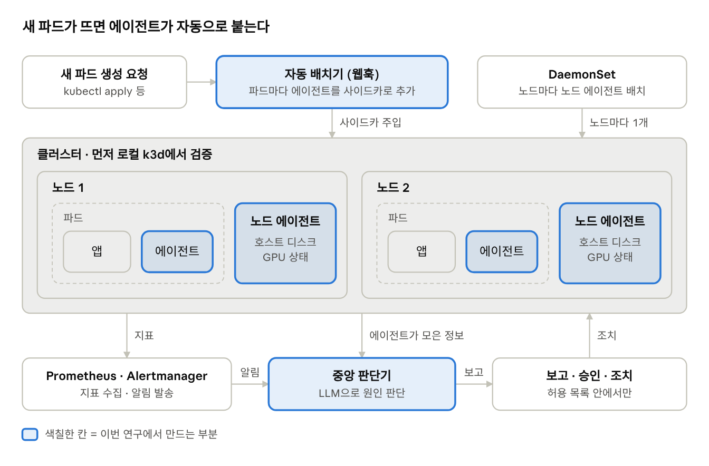

# 장애 대응 에이전트 단계별 구현 계획

컨테이너가 새로 뜰 때마다 장애 대응 에이전트가 자동으로 함께 배치되고, 쿠버네티스가 관리하는 것과 관리하지 못하는 것까지 진단하고 대응하게 만든다. 먼저 맥 로컬(k3d)에서 검증하고, 검증되면 같은 이미지를 학교 GPU 서버와 엣지 기기로 넓힌다.

## 목표

| 목표 | 뜻 | 확인 방법 |
| --- | --- | --- |
| 1. 자동 배치 | 새 파드(컨테이너)가 뜨면 사람이 따로 설정하지 않아도 에이전트가 자동으로 붙는다. 파드가 다른 노드로 옮겨가면 에이전트도 같이 옮겨간다 | 대상 파드 중 에이전트가 붙은 비율 100% |
| 2. 넓은 대응 범위 | 쿠버네티스가 자동으로 하는 일은 확인만 하고, 쿠버네티스가 못 하는 원인 해석·조치 판단·쿠버네티스 밖 문제를 맡는다 | 장애 시나리오별 원인 정확도, 진단·복구 시간 |
| 3. 어디서든 동작 | 같은 이미지가 로컬 → 학교 서버 → 엣지에서 설정만 바꿔 돈다 | 환경별로 같은 시나리오 통과 |

## 전체 진행 단계

지금까지 한 모니터링 공부(0단계)에서 출발해, 에이전트를 맥 로컬에서 검증한 뒤 학교 서버와 엣지로 넓힌다.

| 단계 | 내용 | 환경 | 상태 | 결과물 |
| --- | --- | --- | --- | --- |
| 0. 기반 만들기 | Docker 모니터링(Prometheus·Grafana·Alertmanager), 쿠버네티스 모니터링, 장애 실습 4종 | 맥 로컬 | 완료 (10/30~11/10) | study-log, 기준선(재배치 약 6분, 알림 공백 약 8분) |
| 1. 자동 배치 + 정보 수집 | 새 파드마다 에이전트 자동 주입, 노드마다 노드 에이전트 | 맥 로컬 | 다음 할 일 | 배치 성공률, 배치 부담 측정 |
| 2. 진단 | 알림이 오면 원인을 찾아 보고서 작성 (읽기 전용) | 맥 로컬 | 예정 | 시나리오별 원인 정확도, 진단 시간 |
| 3. 조치 | 승인 후 조치 → 검증된 것만 자동 조치 | 맥 로컬 | 예정 | 복구 시간 비교, 잘못된 조치 0건 |
| 4. 확장 | 같은 이미지를 학교 GPU 서버 → 엣지로 | 학교 서버, 라즈베리파이 5 | 예정 | 환경별 비교표 |

> 0단계 → 3장 conference 원고 / 1~2단계 → 이번 학기 목표 / 1~4단계의 배치 방식 비교 → 졸업논문

각 단계의 구체적인 구현과 완료 기준은 아래 "단계별 구현 계획"에 있다.

## 해결하려는 문제

장애 실습에서 쿠버네티스는 재시작과 재배치는 자동으로 했지만, 원인을 찾고 조치를 고르는 일은 사람이 했다.

| 장애 | 쿠버네티스가 자동으로 한 것 | 사람이 직접 한 것 |
| --- | --- | --- |
| CrashLoopBackOff | 8번 재시작, 간격을 최대 5분까지 늘림 | `describe` → `logs --previous`로 "설정 파일을 찾을 수 없음"이라는 원인 찾기 |
| OOMKilled | limits(128Mi) 초과 시 강제 종료 (Exit Code 137) | `describe`의 Reason으로 판단, limits를 올릴지 앱을 고칠지 결정 |
| 노드 장애 | 약 50초 뒤 NotReady, 그 후 300초 뒤 파드 재배치 (합계 약 6분) | 영향 범위 확인, Alertmanager가 약 8분간 멈춘 것 발견 |
| 앱 전체 중단 | 없음 | 직접 만든 알림(`PodinfoDown`)으로만 감지 |

여기에 문제가 하나 더 있다. 감시·대응 도구를 컨테이너마다 사람이 직접 붙이면, 새로 뜨거나 다른 노드로 옮겨간 컨테이너에서 빠지기 쉽다. 그래서 에이전트를 붙이는 일 자체도 자동이어야 한다.

> 컨테이너마다 에이전트를 자동으로 배치해, 알림이 울린 뒤 원인을 찾고 조치를 고르기까지 사람이 들이는 시간을 줄인다. 단, 에이전트의 잘못된 조치나 에이전트 자신의 자원 부담이 장애를 키우지 않게 한다.

## 에이전트가 다루는 범위

에이전트는 쿠버네티스가 하는 일을 다시 만들지 않는다. 쿠버네티스가 관리하는 것과 관리하지 못하는 것을 나눠, 구간마다 맡을 일을 다르게 정한다.

| 구분 | 예시 | 쿠버네티스가 하는 것 | 에이전트가 할 일 |
| --- | --- | --- | --- |
| A. 쿠버네티스가 관리하는 것 | 죽은 파드 재시작, 노드 장애 시 재배치, HPA 자동 확장 | 정해진 규칙대로 자동 처리 | 다시 만들지 않음. 자동 처리가 실제로 문제를 풀었는지 확인하고 보고서로 설명 |
| B. 관리는 하지만 한계에 걸리는 것 | 원인이 그대로라 재시작만 반복 (11/10: 8번), 재배치까지 약 6분 공백 (11/10), HPA가 최대 replicas에 도달 | 같은 동작만 반복하거나 기다림 | 자동 처리가 안 먹히는 순간을 알아채고 이어받기: 원인 보고, 다음 조치 제안 |
| C. 관리하지 못하는 것 | 원인 해석 ("설정 파일 없음"), limits를 올릴지 앱을 고칠지, 앱 전체 중단 (11/10), Alertmanager 8분 멈춤 (11/10) | 판단하지 않음 | 진단과 판단의 핵심 대상: 로그·이벤트·지표를 모아 원인과 조치를 고름 |
| D. 쿠버네티스 밖 | 호스트 디스크 가득 참, GPU 온도·메모리 (DCGM exporter), 쿠버네티스 없이 Docker로만 도는 컨테이너 | 보이지 않음 | 노드 에이전트가 감시하고 진단. 조치는 보고와 제안까지만 |

"그건 HPA가 하는데요?"라는 질문에는 "HPA가 하는 일은 하지 않고, HPA가 최대치에 걸려 더 못 할 때와 HPA가 볼 수 없는 원인을 맡는다"로 답할 수 있다. 표에서 (11/10)이 붙은 항목은 실습으로 확인한 것이고, 나머지는 실험에서 새로 확인한다.

## 에이전트 구조

에이전트는 세 층이다. 컨테이너 가까이에서 정보를 모으는 컨테이너 에이전트, 노드 전체를 보는 노드 에이전트, 모은 정보로 판단하는 중앙 판단기다. 앞의 둘은 자동으로 배치되고, 판단기는 2주 실습에서 만든 Prometheus·Alertmanager 뒤에 붙는다.

| 구성 요소 | 배치 방식 | 하는 일 |
| --- | --- | --- |
| 자동 배치기 | Deployment + Mutating Admission 웹훅으로 등록 | 라벨이 붙은 namespace에서 파드가 만들어질 때 요청을 가로채 컨테이너 에이전트를 사이드카로 끼워 넣음. kube-system·monitoring은 제외 |
| 컨테이너 에이전트 | 자동 배치기가 파드마다 추가. 파드와 함께 생기고, 옮겨가고, 사라짐 | 같은 파드 안의 앱 로그·프로세스·응답을 확인하고, 쿠버네티스가 모르는 앱 안쪽 상태를 모음. LLM 없이 가볍게 동작 |
| 노드 에이전트 | DaemonSet. 노드가 늘면 자동으로 하나씩 | 호스트 디스크·GPU(DCGM) 감시, 에이전트 없이 뜬 파드 찾기, Docker로만 도는 컨테이너 감시 |
| 중앙 판단기 | Deployment 2개 (서로 다른 노드) | Alertmanager 알림을 받아 두 에이전트의 정보와 정해진 명령 결과를 모으고, LLM이 원인과 조치를 판단해 보고·승인 요청·조치 |

배치 방식은 하나로 고정하지 않고 비교한다. 컨테이너마다 붙이는 방식(사이드카)은 앱 가까이서 많이 보지만 파드마다 자원을 더 쓰고, 노드마다 하나 두는 방식은 가볍지만 앱 안쪽을 덜 본다. 어떤 배치가 어떤 장애에 맞는지가 졸업논문의 "배치" 실험이 된다.

## 단계별 구현 계획

모든 단계는 먼저 맥 로컬(k3d)에서 끝내고, 완료 기준을 통과해야 다음으로 넘어간다. 학교 서버와 엣지는 4단계에서 넓힌다.

1. 자동 배치 + 정보 수집 (로컬)
   - 하는 일: 자동 배치기, 컨테이너 에이전트, 노드 에이전트를 만든다. 이 단계의 에이전트는 상태를 모아 `/metrics`로 내보내기만 하고 판단은 하지 않는다
   - 구현: Python으로 작은 이미지 3개(배치기, 컨테이너 에이전트, 노드 에이전트). 웹훅에 필요한 인증서는 cert-manager 또는 직접 만든 인증서로 준비
   - 완료 기준: 라벨 붙은 namespace에 podinfo를 새로 띄우거나 replicas를 늘리면 모든 파드에 에이전트가 붙음. 노드 장애로 파드가 옮겨가도 붙어 있음. 에이전트 때문에 늘어난 CPU·메모리와 파드 시작 시간을 측정
2. 진단 (읽기 전용, 로컬)
   - 하는 일: 중앙 판단기가 Alertmanager 알림을 받으면 해당 파드의 컨테이너 에이전트·노드 에이전트 정보에 정해진 명령(`describe`, `logs --previous`, 이벤트, PromQL) 결과를 더해, LLM이 원인과 수정안을 보고서로 쓴다
   - 감시 범위: B·C 구간은 쿠버네티스 알림으로, A 구간은 자동 처리 뒤에도 알림이 안 풀리는지로, D 구간은 노드 에이전트 지표로 받는다
   - 권한: 판단기 ServiceAccount는 `get`·`list`·`watch`만
   - 완료 기준: Day 4의 4가지 장애에서 사람이 찾은 원인과 같은 원인 제시
3. 승인 후 조치 → 제한된 자동 조치 (로컬)
   - 하는 일: 허용 목록(파드 재시작, replicas 복구, limits 상향안, 노드 cordon, HPA 최대치 상향안) 안에서 조치를 제안하고, 사람이 승인하면 실행. 계속 맞았던 저위험 조치만 나중에 승인 없이 실행
   - 구현: Discord로 승인, 실행 전 `--dry-run=server`로 결과 미리 보기, 시간당 조치 횟수 제한, 조치 후에도 알림이 안 풀리면 멈추고 사람에게 넘김. D 구간은 보고와 제안까지만
   - 완료 기준: 복구 시간이 사람 기준선보다 짧고, 잘못된 조치 0건
4. 어디서든 동작 (로컬 → 학교 서버 → 엣지)
   - 하는 일: 같은 이미지를 학교 GPU 서버(x86)와 엣지 기기(라즈베리파이 5)로 옮긴다. 쿠버네티스가 없는 Docker 전용 서버에서는 노드 에이전트가 새 컨테이너가 뜨는 것(Docker 이벤트)을 보고 감시 대상에 자동으로 등록한다
   - 구현: `docker buildx`로 ARM·x86 겸용 이미지, 환경 차이는 설정 파일로만 처리. LLM은 로컬 모델과 외부 API 중 설정으로 선택
   - 순서: 학교 서버에는 1·2단계(배치·진단)만 먼저 적용하고, 조치는 교수님과 범위를 정한 뒤에
   - 완료 기준: 세 환경에서 같은 시나리오 통과, 환경별 배치 시간·진단 시간·자원 사용량 표

1·2단계는 지금 있는 환경(k3d, kube-prometheus-stack, podinfo, `PodinfoDown` 규칙)을 그대로 쓰므로 새로 설치할 것이 거의 없다.

## 해결했다는 증빙

같은 장애를 같은 조건으로 다시 일으켜, 사람·기본 쿠버네티스와 에이전트를 숫자로 비교한다. AIOpsLab이 에이전트를 평가하는 방식(장애 주입 → 관찰 → 채점)을 작게 따른다.

실험 방법

1. 장애 시나리오를 스크립트로 만들어 똑같이 주입한다: Day 4의 4개(CrashLoopBackOff, OOMKilled, 노드 장애, 앱 전체 중단)와 범위 표 B·D 구간 3개(HPA 최대치 도달, 호스트 디스크 채우기, Alertmanager 멈추기)
2. 시나리오마다 5회씩, 에이전트 없음 / 배치 방식별(컨테이너마다, 노드마다, 중앙만)로 나눠 반복한다
3. 장애 주입·알림·진단·복구 시각을 로그로 자동 기록한다 (사람이 화면을 보고 재지 않음)

비교 지표

| 지표 | 뜻 | 기준선 |
| --- | --- | --- |
| 배치 성공률 | 대상 파드 중 에이전트가 붙은 비율 | 목표 100% |
| 배치 부담 | 에이전트로 늘어난 CPU·메모리, 파드 시작 지연 | 에이전트 없을 때 측정 |
| 진단 시간 | 알림부터 원인을 말할 때까지 | 사람이 직접 찾음 (재측정 필요) |
| 원인 정확도 | 제시한 원인이 주입한 장애와 맞는 비율 | 사람 4/4 |
| 복구 시간 | 장애 주입부터 알림이 풀릴 때까지 | 노드 장애 약 6분 |
| 알림 공백 | 알림이 아무에게도 전달되지 않은 시간 | 노드 장애 시 Alertmanager 약 8분 |
| 잘못된 조치 | 상황을 더 나쁘게 만든 조치 수 | 목표 0건 |

남길 증빙 자료

- GitHub 저장소(docker-kube-study)에 에이전트 코드, 배포 YAML, 시나리오 스크립트
- 에이전트가 판단마다 남기는 기록(받은 알림, 모은 정보, LLM 답, 조치, 결과)
- 에이전트 자신의 `/metrics`를 Grafana 대시보드로 감시 (붙은 파드 수, 배치 부담, 진단 시간)
- study-log 방식의 날짜별 스크린샷과 트러블슈팅 기록

이 자료가 3장 conference 원고(감시 지표, 모니터링 방식, Prometheus·Grafana 구현)와 졸업논문 배치 실험의 결과 부분이 된다.

## 위험과 안전장치

| 위험 | 안전장치 |
| --- | --- |
| 자동 배치기가 죽으면 파드 생성이 막힘 | 웹훅 `failurePolicy: Ignore`로 배치기가 죽어도 파드는 뜨게 하고, 에이전트 없이 뜬 파드는 노드 에이전트가 찾아 알림. kube-system·monitoring은 대상에서 제외 |
| 에이전트가 앱 자원을 빼앗음 | 사이드카 requests·limits를 작게 고정하고, 배치 부담을 지표로 계속 측정 |
| 틀린 원인으로 잘못된 조치 | 진단은 읽기 전용, 조치는 사람 승인, 자동 조치는 허용 목록의 저위험 조치만 |
| 권한이 너무 넓음 | 컨테이너 에이전트는 쿠버네티스 권한 없이 같은 파드 안만 봄. 판단기는 단계별 ServiceAccount, 삭제·노드 제거 권한은 주지 않음 |
| 같은 조치를 반복 (재시작 루프) | 시간당 횟수 제한, 조치 후에도 알림이 안 풀리면 멈추고 사람에게 넘김 |
| 다른 사람의 작업을 건드림 (공유 GPU 서버) | 대상 namespace를 허용 목록으로 제한, 학교 서버는 배치·진단만 먼저 |
| 서버 정보가 외부 LLM으로 나감 | 로컬 모델 선택지 (RCAgent 방식), 로그에서 비밀번호·토큰 가리기 |
| 에이전트 자신이 죽음 (Day 4의 Alertmanager처럼) | 판단기를 2개, 서로 다른 노드에 두고 에이전트용 TargetDown 알림을 건다 |

## 근거 자료

선행 연구는 LLM 에이전트가 장애 원인 분석에 쓸모 있지만 혼자 맡기기에는 정확도가 부족하다는 것을 보여준다(ReAct 에이전트 정확도 약 35%). 그래서 진단부터 시작해 조치를 단계적으로 열고, 배치는 쿠버네티스가 이미 제공하는 자동 주입 방식 위에 만든다.

| 자료 | 발표처 | 가져올 점 |
| --- | --- | --- |
| [Recommending Root-Cause and Mitigation Steps for Cloud Incidents using LLMs](https://www.microsoft.com/en-us/research/publication/recommending-root-cause-and-mitigation-steps-for-cloud-incidents-using-large-language-models/) | ICSE 2023 (Microsoft) | 실제 장애 4만 건 이상으로 LLM이 원인·조치를 추천할 수 있음을 보임. 출발 근거 |
| [RCACopilot](https://www.microsoft.com/en-us/research/publication/automatic-root-cause-analysis-via-large-language-models-for-cloud-incidents) | EuroSys 2024 (Microsoft) | 알림 종류별로 진단 정보를 먼저 모으고 LLM에 넘기는 구조. 2단계 판단기 구조 |
| [RCAgent](https://arxiv.org/abs/2310.16340) | CIKM 2024 | 내부 데이터를 지키려고 로컬 모델 사용. 로컬 LLM 선택지의 근거 |
| [Exploring LLM-based Agents for Root Cause Analysis](https://arxiv.org/abs/2403.04123) | arXiv 2024 (Microsoft) | 정확도 약 35%, 사람 개입 필요. 진단부터 시작하고 자동 조치는 나중에 |
| [AIOpsLab](https://www.microsoft.com/en-us/research/publication/aiopslab-a-holistic-framework-for-evaluating-ai-agents-for-enabling-autonomous-cloud) | MLSys 2025 (Microsoft) | 장애 주입 → 관찰 → 채점으로 에이전트 평가. 증빙 실험 방식 |
| [HolmesGPT](https://www.cncf.io/blog/2026/01/07/holmesgpt-agentic-troubleshooting-built-for-the-cloud-native-era/) | CNCF Sandbox | Prometheus·이벤트·로그로 진단하는 오픈소스. 비교 대상 |
| [K8sGPT](https://cncf.io/projects/k8sgpt) | CNCF Sandbox | 클러스터 문제를 LLM으로 설명하는 도구. 비교 대상 |
| [Red Hat 자가치유 서버 5단계](https://developers.redhat.com/articles/2023/10/04/5-steps-build-self-healing-server-alertmanager) | Red Hat Developer, 2023 | Alertmanager 웹훅으로 정해진 복구 실행. 허용 목록 조치 방식 |
| [Dynamic Admission Control](https://kubernetes.io/docs/reference/access-authn-authz/extensible-admission-controllers/) | Kubernetes 공식 문서 | 파드 생성 요청을 바꾸는 Mutating 웹훅. 자동 배치기의 기반 |
| [Sidecar Containers](https://kubernetes.io/docs/concepts/workloads/pods/sidecar-containers/) | Kubernetes 공식 문서 | 앱 옆에서 함께 사는 보조 컨테이너. 컨테이너 에이전트의 형태 |
| [Istio 사이드카 자동 주입](https://istio.io/latest/docs/setup/additional-setup/sidecar-injection/) | Istio 공식 문서 | namespace 라벨로 모든 파드에 사이드카를 자동 주입하는 대표 사례. 배치 방식의 선례 |
| [Agent Sandbox](https://agent-sandbox.sigs.k8s.io/docs/getting_started/overview/) | Kubernetes SIG Apps | 에이전트용 격리 실행 환경(gVisor·Kata). 4단계 격리 시험 |

## 교수님과 논의할 점

- [ ] 이번 학기 목표를 어디까지 할지 (제안: 로컬에서 1·2단계, 자동 배치 + 진단 + 비교 실험)
- [ ] 배치 방식 비교(컨테이너마다, 노드마다, 중앙만)를 졸업논문의 "배치" 실험으로 잡아도 되는지
- [ ] 쿠버네티스 밖(호스트 디스크, GPU)까지 범위에 넣을지, 넣는다면 이번 학기엔 진단까지만 할지
- [ ] LLM을 로컬 모델로 할지, 외부 API를 쓸지 (학교 GPU 서버 사용 가능 여부 포함)
- [ ] 학교 서버에 언제, 어느 범위까지 올려봐도 되는지 (처음엔 배치·진단만)
- [ ] 3장 conference는 모니터링 구축과 장애 실습까지만 쓰고, 에이전트는 향후 연구로 둘지
- [ ] 자원관리 논문 읽기를 GPU 클러스터 스케줄링 쪽부터 할지, 엣지 추론 쪽부터 할지

## 출처

- Ahmed T. et al., [Recommending Root-Cause and Mitigation Steps for Cloud Incidents using Large Language Models](https://www.microsoft.com/en-us/research/publication/recommending-root-cause-and-mitigation-steps-for-cloud-incidents-using-large-language-models/), ICSE 2023
- Chen Y. et al., [Automatic Root Cause Analysis via Large Language Models for Cloud Incidents (RCACopilot)](https://www.microsoft.com/en-us/research/publication/automatic-root-cause-analysis-via-large-language-models-for-cloud-incidents), EuroSys 2024
- [RCAgent: Cloud Root Cause Analysis by Autonomous Agents with Tool-Augmented Large Language Models](https://arxiv.org/abs/2310.16340), CIKM 2024
- [Exploring LLM-based Agents for Root Cause Analysis](https://arxiv.org/abs/2403.04123), arXiv 2024
- Chen Y. et al., [AIOpsLab: A Holistic Framework for Evaluating AI Agents for Enabling Autonomous Cloud](https://www.microsoft.com/en-us/research/publication/aiopslab-a-holistic-framework-for-evaluating-ai-agents-for-enabling-autonomous-cloud), MLSys 2025
- CNCF, [HolmesGPT: Agentic troubleshooting built for the cloud native era](https://www.cncf.io/blog/2026/01/07/holmesgpt-agentic-troubleshooting-built-for-the-cloud-native-era/), 2026
- CNCF, [K8sGPT 프로젝트 페이지](https://cncf.io/projects/k8sgpt)
- Red Hat Developer, [5 steps to build a self-healing server with Alertmanager](https://developers.redhat.com/articles/2023/10/04/5-steps-build-self-healing-server-alertmanager), 2023
- Kubernetes, [Dynamic Admission Control](https://kubernetes.io/docs/reference/access-authn-authz/extensible-admission-controllers/)
- Kubernetes, [Sidecar Containers](https://kubernetes.io/docs/concepts/workloads/pods/sidecar-containers/)
- Istio, [Installing the Sidecar](https://istio.io/latest/docs/setup/additional-setup/sidecar-injection/)
- Kubernetes SIG Apps, [Agent Sandbox 개요](https://agent-sandbox.sigs.k8s.io/docs/getting_started/overview/)
- 본인 실습 기록: docker-kube-study 저장소의 study-log.md (11/10 장애 실습)
